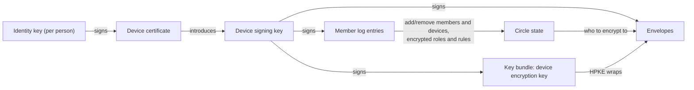

# Kinfold protocol, version 0

**Status:** draft 0.3, November 2026. Not stable: anything here may change before 1.0, and v0 makes no promise of compatibility with later versions. Draft 0.3 applies the November 2026 design review; Appendix D lists what changed since draft 0.2. The test vectors and the three reference implementations in the repository implement this draft (§17).
**License:** [CC BY 4.0](https://creativecommons.org/licenses/by/4.0/). Test vectors: CC0 1.0.
**Labels:** every domain-separation label starts with `kinfold/v0/` (one constant in the reference implementation).

This document specifies the bytes that Kinfold apps, servers and web devices exchange: identities and devices, the circle member log, encrypted envelopes, payloads, invites, device linking, recovery kits, safety codes, share links, server login, silence watches and push. The HTTP API that carries these objects is in [API.md](API.md). Test vectors are in [vectors/kinfold-v0.json](vectors/kinfold-v0.json). The reference implementation is in `reference/python`; `reference/js` and `reference/go` are written from this document alone and check the same vectors.

---

## Contents

1. Introduction
2. Encoding
3. Cryptography
4. Accounts and devices
5. The member log: format
6. The member log: validation
7. Envelopes
8. Payloads
9. Invites and joining
10. Linking devices and recovery
11. Safety codes
12. Share links
13. Server identity and login
14. Silence watches, wake-ups and push
15. Security considerations
16. Registries
17. Test vectors and conformance
- Appendix A. Design decisions
- Appendix B. Open questions
- Appendix C. Implementation notes
- Appendix D. Changes since draft 0.2

---

## 1. Introduction

### 1.1 Goals

- **The server can't read what families share.** Locations, names, avatars, places, chat, roles, guardian relationships, teen rules and pauses are encrypted on the device.
- **The server can't change who is in a circle.** Membership lives in a hash-chained log of entries signed by members' devices. Phones encrypt only to devices that appear in a log they have verified.
- **Every device reaches the same conclusion.** Given the same log and the same keys, every honest client computes the same members, roles and rules, including for entries that break the rules.
- **Implementable with platform crypto.** Everything uses primitives available in CryptoKit (iOS 17+), Tink or the Android platform, Go's standard library and browser WebCrypto: X25519, Ed25519, HKDF-SHA-256, AES-256-GCM, SHA-256/512 and HPKE (RFC 9180) built from them.

### 1.2 What the server learns

The server is given: account IDs and identity public keys; device IDs, device kinds, public keys, and the protocol version and features each device advertises; which accounts are in which circle; **which members are circle admins** (§6.4 explains why this flag is public); each circle's public options and the invite IDs it has used (§6.4); when membership changes and when a new key epoch starts; envelope sizes (padded to buckets), timing, kind, sender device, recipient devices and time-to-live; which uploads ask for a wake-up (§14.3); silence-watch grants and registrations (§14.1); IP addresses at connection time.

The server is never given: positions, names, avatars, places, chat, check-ins, SOS details, the circle's name, who is a teen, who guards whom, teen rules, pauses, or the content of any policy change.

**What it can still infer.** Padding hides sizes and types, not relationships or rhythm:

- Silence watches point from guardians to teens' phones, and only guardians and admins author `POLICY` entries, so a server can usually work out who is a teen and who guards them.
- An upload that asks for a wake-up is an alert of some kind (§14.3), though the server can't tell an SOS from an arrival.
- Upload rhythm shows whether a phone is still, walking or driving. IP addresses show roughly where a phone is and whether it is on its home network.

Hiding these is out of scope for v0. Documentation for users SHOULD say so plainly and SHOULD NOT claim that the server learns nothing.

### 1.3 Conventions

The key words MUST, MUST NOT, SHOULD, SHOULD NOT and MAY are to be interpreted as described in BCP 14 (RFC 2119, RFC 8174) when, and only when, they appear in all capitals.

- **Account:** a person, identified by an identity key.
- **Device:** a phone, tablet, web browser, Home Assistant install or recovery key acting for an account, with its own keys (§16.3).
- **Receiving device:** a device of kind 1–4. A recovery device (kind 5) has no encryption key and never receives anything.
- **Circle:** a group of accounts sharing with each other, defined by its member log.
- **Client:** software on a device. **Server:** the family's Kinfold server.
- `‖` is byte concatenation. `x[a:b]` is bytes a (inclusive) to b (exclusive) of x.

### 1.4 Overview



---

## 2. Encoding

All structures are byte strings built by concatenating fields in order, with no padding and no tags.

| Notation | Meaning |
| --- | --- |
| `u8`, `u16`, `u32`, `u64` | Unsigned integers, big-endian |
| `bytes x[N]` | Exactly N bytes |
| `vec16 x` | `u16` length in bytes, then that many bytes |
| `vec32 x` | `u32` length in bytes, then that many bytes |
| `ids x` | A `vec16` holding 16-byte IDs; its length MUST be a multiple of 16 and the IDs MUST be strictly ascending (bytewise), so lists never contain duplicates |
| `flag x` | A `u8` that MUST be 0 or 1 |
| strings | UTF-8 inside a `vec16`, no terminator |

**Parsing.** A parser MUST reject input that ends before a field is complete, a length that runs past the end of the input, a `flag` other than 0 or 1, an `ids` list that is not a multiple of 16 bytes or not strictly ascending, and any bytes left over after the last field. These failures have the reason code `malformed`.

**Limits.** The sizes and counts that every implementation must agree on are listed in §16.6. Going over one is an error with the reason code shown there, on every platform alike.

**Text forms.** Binary values shown to people or put in URLs use base64url without padding (RFC 4648 §5). Decoders MUST reject padding, characters outside `A–Z a–z 0–9 - _`, and non-canonical encodings (input whose re-encoding differs).

**Codes.** Structures that people scan travel as QR codes holding a four-character prefix followed by base64url:

| Prefix | Structure | Section |
| --- | --- | --- |
| `KFI0` | Invite | 9.1 |
| `KFL0` | Link code | 10.1 |
| `KFR0` | Recovery kit | 10.4 |
| `KFV0` | Safety code | 11 |
| `KFS0` | Server setup | 13.1 |

None of these is a URL. Apps MUST read `KFL0` and `KFR0` codes only through their own scanner (§10.1).

**Time.** Timestamps are `u64` milliseconds since 1970-01-01T00:00:00Z, ignoring leap seconds.

---

## 3. Cryptography

### 3.1 Cipher suite 0x0001

| Function | Algorithm |
| --- | --- |
| Signatures | Ed25519 (RFC 8032), pure mode. Private keys are 32-byte seeds |
| Key agreement | X25519 (RFC 7748). Private keys are 32 bytes, clamped by X25519 itself |
| Hash | SHA-256; SHA-512 for safety codes only |
| KDF | HKDF-SHA-256 (RFC 5869) |
| AEAD | AES-256-GCM, 12-byte nonce, 16-byte tag |
| Public-key encryption | HPKE (RFC 9180) base mode: KEM 0x0020 DHKEM(X25519, HKDF-SHA256), KDF 0x0001 HKDF-SHA256, AEAD 0x0002 AES-256-GCM |

Every structure carries `version = 0` and, where it matters, `suite = 0x0001`. A receiver MUST reject other values.

*Why AES-256-GCM:* browsers' WebCrypto offers AES-GCM but not ChaCha20-Poly1305, phones have AES hardware, and Apple's post-quantum HPKE suite (X-Wing) also uses AES-256-GCM.

### 3.2 Labels

Every hash, signature and derived key is bound to its purpose by an ASCII label of the form `kinfold/v0/<purpose>`. Section 16.4 lists them all. In this document, `"purpose"` in a function call means the full label `kinfold/v0/purpose`.

### 3.3 Hash, sign, derive

```text
H(label, data)           = SHA-256( vec16(label) ‖ data )
Sign(sk, label, data)    = Ed25519-Sign( sk, vec16(label) ‖ data )
Verify(pk, label, data, sig)
KDF(ikm, label, L)       = HKDF-Expand( HKDF-Extract(salt = 32 zero bytes, ikm), info = vec16(label), L )
```

`vec16(label)` is the label's length as a `u16` followed by its ASCII bytes; for `kinfold/v0/log-hash` that is `00 13` then 19 bytes. Truncated hashes such as `H(…)[0:16]` take the first bytes.

**Strict verification.** Members choose their own keys, and Ed25519 libraries disagree about unusual keys and signatures. A single member could otherwise write a log entry that some phones accept and others call broken. So every implementation MUST make the same checks itself before calling its platform's Ed25519 code.

Read a 32-byte public key, or `R` (the first 32 bytes of a signature), as a little-endian integer and clear its top bit (bit 7 of the last byte) to get `y`. `Verify` MUST return false when any of these holds:

1. `S`, the last 32 bytes of the signature as a little-endian integer, is not below the group order `L = 2^252 + 27742317777372353535851937790883648493`.
2. `y` of the public key or of `R` is not below `p = 2^255 − 19`.
3. `y` of the public key or of `R`, written again as 32 little-endian bytes, is one of the five small-order values:

```text
0000000000000000000000000000000000000000000000000000000000000000
0100000000000000000000000000000000000000000000000000000000000000
26e8958fc2b227b045c3f489f2ef98f0d5dfac05d3c63339b13802886d53fc05
c7176a703d4dd84fba3c0b760d10670f2a2053fa2c39ccc64ec7fd7792ac037a
ecffffffffffffffffffffffffffffffffffffffffffffffffffffffffffff7f
```

Otherwise the result is that of RFC 8032 §5.1.7 for a single signature, using the equation without the cofactor, `[S]B = R + [k]A`, with `k` reduced modulo `L` before it is used. Implementations MUST NOT use batch verification. An Ed25519 public key that fails check 2 or 3 is an **invalid key** wherever this document asks for a key check (§4.3, §6.4). A key that passes them but is not a point on the curve needs no separate check: no signature verifies under it.

These checks remove the known differences between the libraries this protocol targets, which verify one signature at a time without multiplying by the cofactor. The W3C Web Cryptography specification asks browsers for the same checks, but an implementation can't rely on its platform for them: Node.js 22, for one, accepts small-order keys. The vectors carry the edge cases, every implementation MUST return the same verdict on each (§17), and a platform's library is trusted only once it has been run against them (Appendix C).

### 3.4 AEAD

`AEAD-Seal(key, nonce, plaintext, aad)` and `AEAD-Open(…)` are AES-256-GCM. Every key in this protocol is either used for exactly one message (with a derived nonce) or used with fresh random 12-byte nonces carried next to the ciphertext.

### 3.5 HPKE

All HPKE use is single-shot base mode with **empty `aad`**; context goes in `info`, which is always a 32-byte `H(…)` value. (Tink's public hybrid API exposes only `info`, called "context info", and RFC 9180 only guarantees `info` up to 64 bytes.)

```text
Seal(pk_R, info, pt)  -> enc (32 bytes), ct (len(pt) + 16 bytes)
Open(enc, sk_R, info, ct) -> pt or failure
```

The sender's ephemeral key MUST be fresh for every seal. Test vectors fix the ephemeral key by giving `ikmE`, from which RFC 9180 `DeriveKeyPair` produces it; platforms that can't inject an ephemeral key (CryptoKit, Tink, most others) skip the byte-exact "seal" checks and run the "open" checks, which are mandatory.

**Key check.** Sealing to a low-order X25519 key fails on every platform, so one member publishing such a key could stop everyone else from sending. An X25519 public key is an **invalid key** when its top bit is set, when it is not below `p = 2^255 − 19` as a little-endian integer, or when it is one of these five values:

```text
0000000000000000000000000000000000000000000000000000000000000000
0100000000000000000000000000000000000000000000000000000000000000
e0eb7a7c3b41b8ae1656e3faf19fc46ada098deb9c32b1fd866205165f49b800
5f9c95bca3508c24b1d0b1559c83ef5b04445cc4581c8e86d8224eddd09f1157
ecffffffffffffffffffffffffffffffffffffffffffffffffffffffffffff7f
```

A key bundle that carries an invalid key is not valid (§4.4).

### 3.6 Randomness

Secrets, nonces and HPKE ephemeral keys MUST come from the platform's cryptographically secure random generator.

---

## 4. Accounts and devices

### 4.1 Keys

| Key | Type | Held by | Purpose |
| --- | --- | --- | --- |
| Identity key (IK) | Ed25519 | The person's phones and tablets, and their recovery kit if they made one | Vouches for the account's devices; its public half is the basis of safety codes |
| Device signing key (DSK) | Ed25519 | One device; never leaves it | Signs log entries, envelopes, key bundles, watch grants and logins |
| Device encryption key (DEK) | X25519 | One receiving device; rotated | Receives HPKE wraps |
| Recovery signing key | Ed25519 | Only the printed recovery kit | The DSK of a recovery device (§10.4) |
| Server key | Ed25519 | The server | Signs the server's identity document, login challenges, pushes and move notices |

The first device creates the IK when the account is created. Linking a phone or tablet (§10) copies the IK to it over an encrypted channel, so any of a person's phones can add devices and replacing a phone doesn't change their safety code. Web and Home Assistant devices never receive the IK.

**Storage.** Private keys are stored sealed by the device's security hardware where it has any (the Secure Enclave on iPhone; StrongBox or the TEE on Android) and are excluded from backups. This document requires that they never leave the device except as stated here, and two things more:

- The DSK and DEK have to work while the phone is locked in a pocket. The IK does not: it is needed only to link a device, join a circle, make a recovery kit or rotate the identity. A phone or tablet MUST seal the IK under a hardware key that asks for the device passcode or biometrics on every use.
- A device whose security hardware can hold an Ed25519 key without exporting it MAY keep its DSK there instead of sealing it.

**After a loss.** Removing a lost or stolen phone from a circle removes its device key, not its knowledge of the IK. Apps MUST offer to rotate the identity key (§6.4, `ROTATE_IDENTITY`) whenever a phone or tablet is removed as lost.

### 4.2 Identifiers

```text
account_id = H("account-id", ik_pub)[0:16]      // of the account's first identity key
device_id  = H("device-id",  dsk_pub)[0:16]
key_id     = H("key-id",     dek_pub)[0:8]
```

An account keeps its ID for life. When its identity key rotates, an identity chain (§4.3) ties the new key back to the first one.

### 4.3 Device certificate and identity chain

The account's IK states that a signing key belongs to one of its devices.

```text
struct DeviceCert {                 // 156 bytes
  u8    version = 0;
  u16   suite = 0x0001;
  bytes account_id[16];
  bytes dsk_pub[32];
  u8    device_kind;                // 1 phone, 2 tablet, 3 web, 4 home-assistant, 5 recovery
  u64   issued_at;
  bytes ik_pub[32];
  bytes sig[64];                    // Sign(IK, "device-cert", the first 60 bytes)
}
```

A certificate is **well-formed** when `version` and `suite` are as shown, `device_kind` is in the registry (§16.3), `ik_pub` and `dsk_pub` are not invalid keys (§3.3), and `sig` verifies under `ik_pub`. Its device ID is `H("device-id", dsk_pub)[0:16]`.

Each rotation of an identity key produces one link:

```text
struct IdentityLink {               // 192 bytes
  bytes old_ik_pub[32];
  bytes new_ik_pub[32];
  bytes old_sig[64];                // Sign(old IK, "identity-rotate", account_id ‖ old_ik_pub ‖ new_ik_pub)
  bytes new_sig[64];                // Sign(new IK, "identity-rotate", account_id ‖ old_ik_pub ‖ new_ik_pub)
}
```

An **identity chain** is a `vec16` of 0 to 8 links. It **proves the account** of a certificate when:

- it is empty and `cert.account_id == H("account-id", cert.ik_pub)[0:16]`; or
- the first link's `old_ik_pub` hashes to `cert.account_id`, each later link's `old_ik_pub` is the link before's `new_ik_pub`, the last `new_ik_pub` is `cert.ik_pub`, no key in it is an invalid key, and every signature verifies with `cert.account_id`.

A person's phones keep the chain with the IK and hand both to newly linked phones (§10.3). An account that has rotated eight times starts a new identity for any further circle.

**After a rotation.** A certificate names the identity key that signed it, so the certificates issued before a rotation no longer name the account's current key. Devices already in a circle's log are not affected: the log knows them by their device keys. But a certificate that is presented again — in `ADD_DEVICE` or `ADD_RECOVERY` for another circle (§6.4), in a join request (§9.2) or as the `sender_cert` of a link response (§10.3) — MUST be under the current identity key. Any phone or tablet that holds the identity key can sign a new certificate for any of the account's devices, its own included, and does so before one is needed.

### 4.4 Key bundle

A device's DSK publishes its current encryption key and what its software supports.

```text
struct KeyBundle {                  // 152 bytes
  u8    version = 0;
  u16   suite = 0x0001;
  bytes account_id[16];
  bytes device_id[16];
  bytes dek_pub[32];
  u64   not_before;
  u64   not_after;
  u8    proto_max;                  // highest protocol version the device's software supports; 0 today
  u32   features;                   // optional features it supports, §16.7; unknown bits are ignored
  bytes sig[64];                    // Sign(DSK, "key-bundle", the first 88 bytes)
}
```

A bundle is **valid for** a device (`dsk_pub`, `account_id`) when `version` and `suite` are as shown, `device_id == H("device-id", dsk_pub)[0:16]`, `account_id` matches, `dek_pub` is not an invalid key (§3.5), `not_before < not_after ≤ not_before + 35 days` (3,024,000,000 ms), and `sig` verifies under `dsk_pub`. `proto_max` and `features` never affect validity.

A bundle is **current at** a time `t` when `not_before ≤ t + 600,000` and `t < not_after`. A bundle must be current when it enters the log (§6.4), so an old one can't be replayed; binding the account ID stops a bundle from being replayed under a different account.

### 4.5 Rotation and deletion

- A receiving device SHOULD publish a new bundle (an `UPDATE_KEY` entry, §5.3, in every circle it belongs to) every 7 days, with `not_after = not_before + 14 days`.
- Senders always use the **current** bundle in the log, even if `not_after` has passed; a stale key only means the device has been offline. Clients MAY show "hasn't been online since …".
- A device MUST keep an old DEK private key until every envelope that could be wrapped to it has expired: at least 30 days (the longest envelope time-to-live) after the bundle that replaced it appeared. It SHOULD delete the key then. This bounds what a stolen phone can decrypt.
- Recovery devices have no bundle and no DEK.

### 4.6 Wraps

A **wrap** carries a 32-byte secret to one device:

```text
struct Wrap {                       // 104 bytes
  bytes recipient_device_id[16];
  bytes key_id[8];                  // key_id of the recipient's current DEK
  bytes enc[32];                    // HPKE encapsulated key
  bytes ct[48];                     // HPKE ciphertext of the 32-byte secret
}
```

`enc, ct = Seal(dek_pub, info, secret)`, where `info` depends on the context (§5.6, §7.3). A list of wraps is a `vec32` whose length MUST be a multiple of 104 (else `malformed`); writers MUST sort wraps by `recipient_device_id`, and readers check that order where this document says so.

To open its wrap, a device finds the entry with its own device ID (none: `not_a_recipient`), looks up the private key for `key_id` (none: `unknown_key`), and opens it (failure, or a result that isn't 32 bytes: `bad_wrap`).

### 4.7 Versions and features

Every receiving device advertises, in its current bundle, the highest protocol version its software supports and the optional features it has (§16.7). v0 defines version 0 and no features. Three rules make later upgrades safe:

- An author MUST NOT write a log entry type, policy subtype, cipher suite or required payload field that some receiving device in the circle doesn't advertise. Until every device has updated, the circle keeps working the old way.
- A client that meets `bad_version` or `unknown_entry_type` in a log (§6.3) MUST tell the person that this circle needs a newer version of the app, and MUST NOT present it as tampering.
- A later version will add a log entry that raises a circle's version once every device advertises it.

---

## 5. The member log: format

### 5.1 Model

Each circle has one append-only log. Entry 0 is `GENESIS`; each later entry names the hash of the one before it. The log has a public part, which the server can check, and an encrypted part — `details` — readable only by members.

Members share an **epoch secret** (32 random bytes). It encrypts the log's details. Epoch 0 starts at genesis. A `REKEY` by an admin, or an admin removing someone else's member or device, starts the next epoch, with the new secret wrapped to every remaining receiving device. Any other removal — someone leaving, a device removing itself, or a non-admin removing a device — can't choose the next secret, because the person or device leaving would know it, and only admins create secrets; it marks a **rekey pending** instead, and no encrypted entry may be written until an admin rekeys (§6.4). Either way, a removed member can't read details added after they left. New members and devices receive all past epoch secrets when they join, so they can verify the whole log.

### 5.2 Entry

```text
struct LogEntry {                   // at most 65,536 bytes
  // header: 88 bytes
  u8    version = 0;
  u16   suite = 0x0001;
  u8    entry_type;                 // §16.1
  bytes circle_id[16];              // all zero in GENESIS
  u64   seq;                        // 0 for GENESIS, then +1
  bytes prev_hash[32];              // all zero in GENESIS
  u64   created_at;
  bytes author_device_id[16];
  u32   epoch;                      // the circle's current epoch when written
  // ---
  vec32 body;                       // §5.3
  bytes sig[64];                    // Sign(author DSK, "log-entry", everything before sig)
}

entry_hash = H("log-hash", entire entry including sig)
circle_id  = H("circle-id", entire GENESIS entry)[0:16]
```

### 5.3 Entry types and bodies

| Code | Type | Body |
| --- | --- | --- |
| 0x01 | `GENESIS` | `DeviceCert founder_cert; vec16 chain; KeyBundle founder_bundle; bytes epoch_commit[32]; bytes details[540]` |
| 0x02 | `ADD_MEMBER` | `DeviceCert cert; vec16 chain; KeyBundle bundle; bytes invite_id[16]; bytes terms_commit[32]; bytes consent_sig[64]; flag admin; bytes details[540]` |
| 0x03 | `REMOVE_MEMBER` | `bytes account_id[16]; bytes epoch_commit[32]; vec32 wraps` |
| 0x04 | `ADD_DEVICE` | `DeviceCert cert; KeyBundle bundle` |
| 0x05 | `REMOVE_DEVICE` | `bytes device_id[16]; bytes epoch_commit[32]; vec32 wraps` |
| 0x06 | `UPDATE_KEY` | `KeyBundle bundle` |
| 0x07 | `POLICY` | `bytes details[540]` |
| 0x08 | `REKEY` | `bytes epoch_commit[32]; vec32 wraps` |
| 0x09 | `SET_ADMIN` | `bytes account_id[16]; flag admin` |
| 0x0A | `ADD_RECOVERY` | `DeviceCert cert` |
| 0x0B | `SET_OPTIONS` | `u32 options` |
| 0x0C | `ROTATE_IDENTITY` | `IdentityLink link` |

A body MUST be exactly as listed, with no bytes left over; a `chain` MUST be a multiple of 192 bytes and at most 1,536. Failures are `malformed`. In a removal that doesn't start an epoch (§6.4), `epoch_commit` is 32 zero bytes and `wraps` is empty.

- **ADD_MEMBER** adds one account with its first device. `invite_id`, `terms_commit` and `consent_sig` come from the join request (§9): `consent_sig = Sign(new member's IK, "join-consent", circle_id ‖ invite_id ‖ cert ‖ bundle ‖ terms_commit)`. It proves the person asked to join *this* circle with *these* keys on *these* terms, and it can be used once.
- **ADD_DEVICE** adds a receiving device to the author's own account. **ADD_RECOVERY** adds a recovery device, which has no key bundle (§10.4).
- **POLICY** changes encrypted state only: rules, guardians, pauses, the circle's name (§5.5).
- **SET_ADMIN** grants or removes the admin flag. **SET_OPTIONS** replaces the circle's public options (§16.7).
- **ROTATE_IDENTITY** replaces the author's identity key (§4.3).

### 5.4 Encrypted details

```text
log_key(e) = KDF(epoch_secret_e, "log-key", 32)
details    = nonce[12] ‖ AEAD-Seal(log_key(entry.epoch), nonce, PadTo(plaintext, 512), aad = the entry's 88-byte header)
```

`PadTo` is defined in §7.4. Every `details` field is therefore exactly 540 bytes whatever it holds, so its length says nothing about a member's role or about which policy changed.

The nonce MUST be 12 fresh random bytes for every encryption. (A deterministic nonce would repeat when an append loses a race and is rebuilt at the same `seq`, §6.7.) The header as AAD binds the details to this exact position, author and epoch.

### 5.5 Private structures

These are the plaintexts inside `details`, before padding.

```text
struct GenesisDetails { vec16 circle_name; }            // UTF-8, 1–128 bytes

struct MemberTerms {                // what a new member is asked to accept (§9)
  u8    role;                       // 1 adult, 2 teen
  u64   teen_until;                 // teen: when teen settings may end (> created_at); adult: 0
  ids   guardians;                  // teen: 1–8 adult members; adult: empty
  Rules rules;                      // teen: initial rules; adult: any valid Rules, ignored
}
struct MemberDetails {
  bytes terms_salt[16];             // from the invite
  MemberTerms terms;
}
terms_commit = H("member-terms", terms_salt ‖ MemberTerms)

struct Rules {
  u8    pause_mode;                 // 0 never, 1 ask each time, 2 ask, or pause freely inside schedule windows
  u8    approx_mode;                // same values, for approximate location
  u16   speed_alert_kmh;            // 0 off, at most 300
  u8    phone_use_alerts;           // 0 or 1
  u8    history_days;               // 1–30
  u16   silence_alert_min;          // 0 off, otherwise 15–1440
  vec16 tz;                         // IANA time zone for the schedule, such as "America/Vancouver"; 0–64 bytes
  vec16 schedule;                   // 0–32 Window structs, 6 bytes each
}
struct Window {
  u8    kind;                       // 1 pause allowed, 2 approximate allowed
  u8    days;                       // bit 0 Monday … bit 6 Sunday; 1–127
  u16   start_min;                  // minutes after midnight in the zone `tz` names
  u16   end_min;                    // start_min < end_min ≤ 1440
}

struct Policy {
  u8 subtype;                       // §16.2
  select (subtype) {
    case SET_RULES:       bytes target[16]; Rules rules;
    case SET_GUARDIANS:   bytes target[16]; ids guardians;      // 1–8
    case GRANT_PAUSE:     bytes target[16]; bytes pause_id[8]; u8 kind; u64 start; u64 end;
    case REVOKE_PAUSE:    bytes target[16]; bytes pause_id[8];
    case END_TEEN:        bytes target[16];
    case SET_CIRCLE_NAME: vec16 name;   // UTF-8, 1–128 bytes
  }
}
```

`Rules` is **valid** when every field is within the ranges in the comments, `tz` uses only the characters `A–Z a–z 0–9 / _ - +`, and `tz` is not empty when `schedule` is not. Defaults for a new teen: pause_mode 1, approx_mode 1, speed off, phone-use alerts off, 7 days of history, silence alert after 60 minutes, empty `tz`, no schedule. An adult's `MemberTerms` SHOULD carry these defaults.

Schedule windows are read in the time zone that `tz` names, by trusted time (§8.4), never by the phone's own clock or zone setting. A device that doesn't know the zone treats every window as closed and says so in its heartbeat. A window crossing midnight is written as two windows. In `GRANT_PAUSE`, kind 1 pauses sharing (heartbeats only) and kind 2 allows approximate location; `pause_id` is the teen's request ID (§8.4).

### 5.6 Epochs and epoch wraps

```text
epoch_commit = H("epoch-commit", u32(epoch) ‖ epoch_secret)
```

`GENESIS` commits to epoch 0. A `REKEY`, and a removal by an admin who stays in the circle (§6.4), start epoch `n + 1` (where `n` is the entry's `epoch` field), commit to its secret, and carry one wrap of the new secret for **every receiving device active after the entry**, using that device's current key:

```text
info = H("epoch-wrap", circle_id ‖ u64(seq) ‖ prev_hash ‖ u32(n + 1) ‖ recipient_device_id ‖ key_id)
```

where `circle_id`, `seq` and `prev_hash` are this entry's. A recipient MUST check that the opened secret matches `epoch_commit`; if its wrap fails to open or the secret doesn't match, the device is **locked out** of that epoch: it follows §6.5's rule for missing secrets and asks the circle for a `refresh` (§8.5). The commitment also guarantees that every member received the same secret.

---

## 6. The member log: validation

### 6.1 State

A circle's state after an entry is:

- `circle_id`, `seq`, `head` (hash of the last entry), the set of all entry hashes, `epoch`, the commitment for each epoch, `rekey_pending`, the circle's `options` (§16.7) and the set of invite IDs already used. *(Public.)*
- **Members**, by account ID, each with: current identity public key; `admin` flag; devices (device ID, DSK public key, kind and, for receiving devices, the current key bundle). *(Public.)*
- Per member, private: `role` (adult or teen), `teen_until`, `guardians`, `rules` (teens only), and stored `pauses` (`pause_id` → kind, start, end; at most 16, whether or not in force). The circle's `name`. A list of **flags**: `(seq, reason)` for every rejected entry and every entry accepted with unreadable details. `private_unknown_from`: the `seq` from which this client couldn't run the private rules (§6.5), normally none.

An **active device** is a device of a current member. A **receiving device** is an active device of kind 1–4. A **current admin** is a member whose admin flag is set.

### 6.2 Outcomes

Each entry has exactly one outcome:

| Outcome | Meaning | Who can tell |
| --- | --- | --- |
| **fatal** | The log is broken at this entry. A server MUST refuse to append it. A client that receives it MUST NOT apply it or anything after it. For `bad_version` and `unknown_entry_type` it tells the person the circle needs a newer app (§4.7); for anything else, that the circle's history can't be verified. | Server and clients |
| **accepted** | Applied. | Server and clients |
| **accepted, flagged `bad_details`** | Public effects applied; the encrypted details were unreadable or invalid, so a default is used (§6.5). | Clients |
| **rejected** | Only `POLICY` entries can be rejected. The entry stays in the chain (its hash becomes the head) but changes nothing else, and is flagged. | Clients |
| **deferred** | The client lacks the epoch secret for this entry's details, or its private state is already frozen (§6.5): public effects applied, private rules wait for the secret. | Clients |

Every fatal reason is detectable from public data, so an honest server never stores a fatal entry; seeing one means the server misbehaved or the app is out of date. Everything that depends on encrypted data can only *reject* or *flag*, never break the chain, so a misbehaving member can't lock a family out of its own circle. All honest clients holding the same epoch secrets reach the same outcome for every entry; one missing a secret defers instead (§6.5) and catches up when the secret arrives.

A server runs §6.3 steps 1–9 and applies the public effects in step 11 ("public mode"); a client runs all of it. Servers also check `created_at` against their own clock (§6.7); the vectors leave that check out because it depends on the clock.

### 6.3 Processing order

To process an entry, perform these checks in order; the first failure determines the outcome and reason code.

1. The entry is at most 65,536 bytes (→ fatal `too_large`). Parse the entry framing (§5.2): header, `vec32 body`, 64-byte signature, nothing left over. → fatal `malformed`
2. `version == 0` and `suite == 0x0001`. → fatal `bad_version`
3. `entry_type` is in §16.1. → fatal `unknown_entry_type`
4. Parse the body for its type (§5.3), including the certificates, chains, bundles and wrap lists inside it. → fatal `malformed`
5. Position. If the log is empty: the entry MUST be `GENESIS` and its `seq` 0 (either failure → `bad_seq`), `prev_hash` all zero (→ `bad_prev_hash`), `circle_id` all zero (→ `bad_circle_id`) and `epoch` 0 (→ `bad_epoch`). Otherwise: not `GENESIS` (→ `unexpected_genesis`), `seq` = previous `seq` + 1 (→ `bad_seq`), `prev_hash` = current head (→ `bad_prev_hash`), `circle_id` matches (→ `bad_circle_id`), `epoch` = current epoch (→ `bad_epoch`). All fatal.
6. Author. In `GENESIS`, `author_device_id` MUST equal the founder certificate's device ID (→ fatal `bad_author`) and the author's key is that certificate's `dsk_pub`. Otherwise the author MUST be an active device (→ fatal `author_not_active`).
7. `sig` verifies under the author's DSK (§3.3). → fatal `bad_signature`
8. The author device's kind may write this entry (table below). → fatal `kind_not_allowed`
9. The type's public rules (§6.4), in the order listed. → fatal, with the reason shown.
10. *(Clients.)* The type's private rules (§6.5).
11. Apply the entry's effects, set `seq` and `head`, then *(clients)* run guardian repair (§6.6).

| Author's device kind | May author |
| --- | --- |
| phone, tablet | Every entry type |
| web, home-assistant | `UPDATE_KEY`; `REMOVE_DEVICE` naming the author device itself |
| recovery | `ADD_DEVICE`; `REMOVE_DEVICE` naming an active device of the author's own account |

In `GENESIS` the author's kind is the founder certificate's, so only a phone or tablet can found a circle; a kind outside the registry (§16.3) may author nothing. Step 8 comes before the rules of step 9, so a recovery device naming a device that isn't active gets `kind_not_allowed`, not `unknown_device`. The table holds whatever software drives the device: a web session or a Home Assistant box can never add or remove people, change admins, options or teen rules, or take its owner's phone out of a circle, and a found recovery kit can do nothing beyond its own account's devices.

### 6.4 Public rules

"The author" means the author device's account.

**GENESIS** — `founder_cert` is well-formed and `chain` proves its account (§4.3) (`bad_cert`); `founder_bundle` is valid for it and current at `created_at` (`bad_bundle`). *Effect:* `circle_id` is computed (§5.2); the founder becomes the only member, an admin, with one device; epoch 0's commitment is recorded; `options` is 0 and no invite ID is used.

**ADD_MEMBER** — the author is an admin (`not_admin`); no rekey is pending (`rekey_pending`); the circle has fewer than 32 members (`too_many_members`); `cert` is well-formed and `chain` proves its account (`bad_cert`); `cert.device_kind` is 1 or 2 (`kind_not_allowed`); `bundle` is valid for `cert`'s device and account and current at `created_at` (`bad_bundle`); `cert.account_id` is not a current member and `cert.ik_pub` is no current member's identity key (`already_member`); `cert`'s device is not an active device (`device_active`); `invite_id` has not been used in this circle (`invite_reused`); `consent_sig` verifies under `cert.ik_pub` over `circle_id ‖ invite_id ‖ cert ‖ bundle ‖ terms_commit` (`bad_consent`). *Effect:* the account becomes a member, admin if `admin` is 1, with one device, and `invite_id` is recorded as used.

**REMOVE_MEMBER** — `account_id` is a current member (`not_member`); the author is an admin, or is that account (`not_admin`); if the target is an admin and the only one, it is also the only member (`last_admin`). If the author is an admin and not the target, the wraps (below) cover every receiving device of the remaining members (`bad_wraps`), the epoch advances and any pending rekey is cleared; otherwise `epoch_commit` is all zero and there are no wraps (`bad_wraps`), and the circle is marked rekey pending. *Effect:* the member and their devices are removed.

**ADD_DEVICE** — `cert` is well-formed (`bad_cert`); `cert.account_id` is the author's account and `cert.ik_pub` is that member's current identity key (`wrong_account`); `cert.device_kind` is 1–4, and the circle's options allow it if it is 3 or 4 (`kind_not_allowed`); the account has fewer than 8 devices (`too_many_devices`); `bundle` is valid for `cert`'s device and account and current at `created_at` (`bad_bundle`); the device is not already active (`device_active`). *Effect:* the device is added to the author's account.

**ADD_RECOVERY** — `cert` is well-formed (`bad_cert`); `cert.account_id` is the author's account and `cert.ik_pub` is that member's current identity key (`wrong_account`); `cert.device_kind` is 5 (`kind_not_allowed`); the account has no recovery device and fewer than 8 devices (`too_many_devices`); the device is not already active (`device_active`). *Effect:* the recovery device is added to the author's account, with no key bundle.

**REMOVE_DEVICE** — `device_id` is an active device (`unknown_device`); it belongs to the author's account, or the author is an admin (`not_admin`); it is not its account's only device — remove the member instead (`last_device`). Then one of three cases:

- The device is a recovery device: `epoch_commit` is all zero and there are no wraps (`bad_wraps`). Nothing else changes, because a recovery device never held an epoch secret.
- The author is an admin writing from a device other than the one being removed: the wraps cover every other receiving device (`bad_wraps`), the epoch advances and any pending rekey is cleared.
- Otherwise: `epoch_commit` is all zero and there are no wraps (`bad_wraps`), and the circle is marked rekey pending.

*Effect:* the device is removed.

**UPDATE_KEY** — `bundle` is valid for the author device and its account and current at `created_at`, and its `key_id` differs from the device's current one (`bad_bundle`). *Effect:* the bundle becomes the device's current key.

**POLICY** — no rekey is pending (`rekey_pending`). Its effect is private (§6.5).

**REKEY** — the author is an admin (`not_admin`); the wraps cover every receiving device (`bad_wraps`). *Effect:* the epoch advances and any pending rekey is cleared.

**SET_ADMIN** — the author is an admin (`not_admin`); `account_id` is a current member (`not_member`); the entry doesn't remove the admin flag from the only admin (`last_admin`). *Effect:* the flag is set to `admin`.

**SET_OPTIONS** — the author is an admin (`not_admin`); `options` sets no bit that §16.7 leaves undefined (`bad_options`). *Effect:* the circle's options are replaced. Clearing a bit doesn't remove devices already added; apps SHOULD offer to remove them.

**ROTATE_IDENTITY** — `link.old_ik_pub` is the author's current identity key; `link.new_ik_pub` is not an invalid key (§3.3), differs from it and is no current member's identity key; both signatures verify with the author's account ID (§4.3). Any failure is `bad_rotation`. *Effect:* the author's identity key becomes `link.new_ik_pub`. The account ID and the account's devices don't change. The phone that rotates gives the new key and chain to the account's other phones and tablets (§8.2, `ik`), appends the same link to every circle the account is in, signs new certificates as they are needed (§4.3), and replaces any recovery kit (§10.4), since a kit made before the rotation holds the old key and can no longer add a device.

**Who creates epoch secrets.** Only an admin who stays in the circle. A member who leaves or removes their own device would know any secret they created, so their removal starts no epoch; and since only the recipient can tell whether a wrap opens, limiting who hands out wraps limits who could hand out ones that don't. While a rekey is pending, `ADD_MEMBER` and `POLICY` entries are refused; every admin phone or tablet that sees the flag SHOULD append a `REKEY` after a random delay of up to a minute (the append conflict of §6.7 lets only one through). The cost: until an admin's device is online, guardians can't change rules or grant pauses either, which is one reason guardians should be admins (below).

**Wrap coverage** (`bad_wraps`): the wraps are strictly ascending by device ID, there is exactly one for each device in the required set and none for any other device, and each wrap's `key_id` is the key ID of that device's current bundle. The server can check all of this; only the recipient can check that its own wrap opens (§5.6).

**Why the admin flag is public.** Membership changes have public effects: the server must stop serving a removed member, and an ex-partner who has been removed shouldn't keep seeing even the timing of the family's updates. If the right to add or remove people depended on encrypted data, the server couldn't tell a real removal from a forged one, and the server's view of the circle could drift from the members' view. So every entry with a public effect is decided by public rules only, and the facts those rules need — who is an admin, which device kinds the circle allows, which invites are spent — are public. Teen status, guardianship and rules stay private, and only `POLICY` entries depend on them. Three consequences follow, all deliberate:

- **Anyone can leave.** A self-removal from a phone or tablet is valid for every member, including a teen, and leaves a rekey pending. The one exception is the only admin while others remain, who must first make someone else an admin (`last_admin`). When the last member leaves, the circle is closed: with no active devices no entry can follow, and the server MAY delete it. The protocol can't stop a phone from going silent anyway; what it guarantees is that leaving is visible. The app offers teens "Ask to leave" rather than "Leave", and when a teen's self-removal appears, every client MUST show it to the teen's guardians (§6.8).
- **Admin is a public permission, not a role.** The protocol lets an admin make any member an admin; apps offer it only for adults.
- **A circle needs more than one admin.** If the only admin's only phone is lost, nobody can remove it, invite, rekey or appoint another admin. Apps SHOULD make every guardian an admin, and MUST warn while a circle has a single admin whose account has neither a second phone or tablet nor a recovery device (§10.4).

### 6.5 Private rules (clients)

Clients normally hold every epoch secret up to the current one (from joining, wraps or a `refresh`) and use `key = log_key(entry.epoch)`.

**Missing secrets.** A secret counts only if it matches the log's `epoch_commit`; a client MUST discard one that doesn't. Only entries with details — `GENESIS`, `ADD_MEMBER` and `POLICY` — need their epoch's secret. A client that lacks it for such an entry MUST apply only the public effects of that entry and every later one (their outcome is **deferred**), MUST treat its private state (roles, guardians, rules, pauses, the circle's name) as unknown from that entry on, and MUST NOT author `POLICY` or `ADD_MEMBER` entries from it. Once it obtains the secret, it runs the private rules again from that entry, in order. This keeps every client's private state identical: a missing secret never produces `bad_details`. In the vectors, a frozen state has `private_unknown_from` set to the first such `seq`, and its private fields keep their last known values.

A frozen device does not drop the rules it already knew. If its own account was a teen when its state froze, it keeps following the rules it last knew, MUST NOT begin a pause that would need a new approval, and reports `locked_out` in its heartbeats (§8.4) until it catches up. Other clients keep showing members under their last known roles.

**Failures inside details.** Failing to open the ciphertext or to remove the padding, and any structural failure while parsing — a length, an `ids` list out of order, a `flag` out of range, a `schedule` whose length isn't a multiple of 6, bytes left over — is `bad_details`. The other reasons below are for values that parse but break a rule.

**GENESIS** — open `details`, parse `GenesisDetails`, check the name. If any step fails, the circle's name is empty and the entry is flagged `bad_details` (still accepted). The client MUST check `epoch_commit` against the epoch-0 secret it was given.

**ADD_MEMBER** — open `details` and parse `MemberDetails`. The details are valid when `H("member-terms", terms_salt ‖ terms) == terms_commit` and either

- `role` is 1 (adult), `teen_until` is 0, `guardians` is empty and `rules` is valid; or
- `role` is 2 (teen), `teen_until > created_at`, there are 1 to 8 guardians, every guardian is a current member whose role is adult (the new member doesn't count), and `rules` is valid.

If valid, the new member gets that role, `teen_until`, guardians and (for teens) rules. Otherwise the member is added as an **adult** and the entry is flagged `bad_details`. This is the only way teen status is ever set: it can't be applied to an existing member, and because the new member signed `terms_commit`, nobody can be given a role, guardians, an end date or rules other than the ones their join screen showed them (§9).

**POLICY** — checks in order; the first failure rejects the entry with the reason shown:

1. `details` opens and parses as `Policy` (for a known subtype, nothing left over). → `bad_details`
2. `subtype` is in §16.2; an unknown subtype is not parsed further. → `unknown_policy`
3. `SET_CIRCLE_NAME`: the author is an admin (→ `not_admin`) and the name is 1–128 bytes of valid UTF-8 (→ `bad_details`). *Effect:* the circle's name changes. Stop here.
4. `target` is a current member (→ `not_member`) whose role is teen (→ `not_teen`).
5. `END_TEEN`: the author must be one of the target's guardians; or the target themselves, provided `created_at ≥ teen_until` (→ `teen_until_not_reached`); anyone else → `not_guardian`. *Effect:* the target becomes an adult; `teen_until`, guardians, rules and pauses are cleared. Stop here.
6. The author is one of the target's guardians. → `not_guardian`
7. By subtype:
   - `SET_RULES`: `rules` is valid (→ `bad_rules`). *Effect:* the rules are replaced.
   - `SET_GUARDIANS`: the list has 1 to 8 entries and every entry is a current adult member (→ `bad_guardians`). *Effect:* the guardians are replaced.
   - `GRANT_PAUSE`: `kind` is 1 or 2, `start < end ≤ start + 24 hours` (86,400,000 ms), and `pause_id` is not one of the target's stored pauses (→ `bad_pause`). *Effect:* if the target already has 16 stored pauses, the one with the earliest `end` is dropped (ties: the lowest `pause_id`); then the pause is added.
   - `REVOKE_PAUSE`: `pause_id` is one of the target's stored pauses (→ `unknown_pause`). *Effect:* it is removed.

`created_at` is the author's clock, checked by an honest server to within 10 minutes (§6.7), which is why a teen can end their own teen settings only once `teen_until` has passed by that clock. A pause is in force while `start ≤ now < end` by the teen device's trusted time (§8.4); expired pauses have no effect.

### 6.6 Guardian repair

After applying every non-fatal entry, clients repair guardianship. Let *A* be the current members whose role is adult and *D* those of them who are admins, both as they stand before the repair. For each teen:

1. Drop from their guardians anyone who is not in *A*.
2. If none remain, their guardians become *D*, in ascending order of account ID (the first 8).
3. If there are still none, *A* (the first 8).
4. If there are still none, the teen's teen settings end, as with `END_TEEN`.

Every teen is judged against the same *A* and *D*; a teen whose settings end in step 4 becomes an adult only after the pass, so one teen never becomes another's guardian through repair.

This keeps the rule "a teen always has at least one guardian" true even when the last guardian leaves, which the protocol can't prevent (§6.4). Apps SHOULD make a guardian hand over guardianship before leaving, so repair is a fallback.

### 6.7 Appending

- To append, a client builds the entry on the head it knows and posts it. The server MUST check §6.3 steps 1–9 and that `created_at` is within 10 minutes of its own clock (`bad_time`), and MUST append entries one at a time. If the head has moved, the server answers with a conflict; the client fetches the new entries, validates them, re-checks that its change still makes sense, and rebuilds its entry from scratch — new `seq`, `prev_hash`, details nonce, wraps and signature.
- A client MUST validate entries it authors with the full rules before posting. Honest clients never author fatal entries, and SHOULD NOT author entries they know will be rejected.
- Clients MUST keep the highest `seq` and head they have verified and MUST NOT accept a log that is shorter or that diverges from it (rollback protection).
- A new member's welcome (§8.5) carries the head it was sent at; the joining device fetches and verifies the log from genesis to at least that head.
- Servers limit how often one device may append (API.md). A junk `POLICY` entry is rejected by clients but stays in the chain, so the limit is what keeps a member from bloating the log.

**Repair after a server loses entries.** A server restored from a backup holds logs that are prefixes of what clients hold. Clients keep their own verified logs and never adopt the shorter one. While the operator has switched on repair mode (API.md), a client whose verified log extends the server's re-posts the missing entries in order, and the server takes no new entries, so that a phone that has been offline since the backup can't start a second branch. The server checks each with §6.3 steps 1–9 and appends it; in repair mode `created_at` may be older than the server's clock by any amount but still MUST NOT be more than 10 minutes ahead of it. Outside repair mode, a shorter log from the server is a rollback attempt, as before.

### 6.8 Alerts

Everyone is told when the circle changes; that is part of the protocol, not an app nicety. A client MUST show, to every member:

- a member added or leaving or removed; a device added or removed, with its kind; a recovery device added, or used to add a device;
- an identity key rotated, and any other change of safety code;
- a change to the circle's options, such as web devices being allowed;
- for teens' guardians in particular: a teen leaving on their own, a teen's new device, guardianship changes, and teen settings ending.

Clients SHOULD show admins any rejected or flagged entry ("Maya tried to change her own rules"). Clients SHOULD remember identity keys that a rotation retired and warn if one ever appears as someone's current key.

### 6.9 State hash

Private state that differs between two honest clients would be silent: neither breaks the chain. So that differences show up, clients compute a short hash of the whole state and send it in heartbeats (§8.2):

```text
state_hash = H("state-hash", StateBytes)[0:8]

StateBytes =
  circle_id[16] ‖ u64 seq ‖ head[32] ‖ u32 epoch ‖ flag rekey_pending ‖ u32 options ‖ vec16 name ‖
  u16 member_count ‖ for each member, ascending by account ID:
    account_id[16] ‖ ik_pub[32] ‖ flag admin ‖ u8 role ‖ u64 teen_until ‖ ids guardians ‖
    vec16 rules ‖                       // the Rules bytes for a teen; empty for an adult
    u16 pause_count ‖ for each stored pause, ascending by pause_id: pause_id[8] ‖ u8 kind ‖ u64 start ‖ u64 end ‖
    u16 device_count ‖ for each device, ascending by device ID: device_id[16] ‖ u8 kind ‖ key_id[8]
```

A recovery device's `key_id` is 8 zero bytes. A client with frozen private state (§6.5) sends no state hash. A client that receives a heartbeat whose `log_head` it has processed, and whose state hash differs from its own at that head, SHOULD record the mismatch and tell the circle's admins that two devices disagree about the circle; it MUST NOT change its own state because of it.

---

## 7. Envelopes

An envelope carries one encrypted payload from one device to some devices of a circle.

### 7.1 Structure

```text
struct EnvelopeHeader {             // 88 bytes
  u8    version = 0;
  u16   suite = 0x0001;
  u8    kind;                       // 1 circle (everyone), 2 direct (chosen devices)
  bytes circle_id[16];
  bytes sender_device_id[16];
  u64   seq;                        // per sender device and circle; strictly increasing; starts at 1
  u64   sent_at;
  u32   ttl_s;                      // seconds the server keeps it: 60 to 2,592,000 (30 days)
  bytes log_head[32];               // the sender's verified log head
}

struct Envelope {
  EnvelopeHeader header;
  vec32 wraps;                      // Wrap structs (§4.6), strictly ascending by device ID
  vec32 ciphertext;
  bytes sig[64];                    // Sign(sender DSK, "envelope", everything before sig)
}
```

### 7.2 Recipients

- **kind 1 (circle):** every receiving device at `log_head` except the sender device itself — including the sender's other devices.
- **kind 2 (direct):** any non-empty set of receiving devices, for example one member's devices or a newly joined device.

A sender MUST be a receiving device, and MUST use only devices from a log it has verified and each device's current key. Receivers SHOULD warn when a circle envelope omits devices it should include, but MUST NOT reject it for that reason, since the receiver's head may differ from the sender's. The server does enforce it (§7.5).

### 7.3 Encryption

```text
message_secret = 32 random bytes, new for every envelope
wrap info      = H("wrap", header ‖ recipient_device_id ‖ key_id)
payload_key    = KDF(message_secret, "payload-key", 32)
payload_nonce  = KDF(message_secret, "payload-nonce", 12)
aad            = H("env-aad", header ‖ vec32(wraps))      // the envelope's bytes up to the end of wraps
ciphertext     = AEAD-Seal(payload_key, payload_nonce, Pad(payload), aad)
```

Each wrap seals `message_secret` (§4.6). Because `message_secret` is used for one envelope only, the derived nonce is safe.

### 7.4 Padding

Padding hides the payload's type and size. The buckets are 256, 512, 1024, 2048, 4096, 8192, 16384 and 65536 bytes; payloads may be at most 65,535 bytes.

```text
PadTo(p, n) = p ‖ 0x80 ‖ zero bytes, to exactly n bytes; len(p) MUST be at most n − 1
Pad(p)      = PadTo(p, the smallest bucket ≥ len(p) + 1)
Unpad(x)    = strip trailing 0x00 bytes; the last byte left MUST be 0x80; remove it
```

Before `Unpad`, the length of `x` MUST be a bucket size for envelopes and share updates, exactly 512 for log details (§5.4) and exactly 2,560 for pushes (§14.2).

### 7.5 Sending

The sender builds the header, wraps, ciphertext and signature in that order and posts the envelope. Before storing it, the server runs §7.6 steps 1–10 with its own clock (it holds the whole log, so nothing needs fetching), and then checks that:

- every wrap names a receiving device (→ `bad_wraps`);
- `ttl_s` is in range (→ `bad_ttl`);
- for a circle envelope, `log_head` is at or after the last entry that changed the circle's set of receiving devices (→ `stale_head`), and the wraps name exactly the receiving devices except the sender (→ `bad_wraps`).

The last check means a phone can't quietly leave someone out of its updates, and it lets silence watches count circle envelopes only (§14.1). A sender that gets `stale_head` or `bad_wraps` fetches the log and builds the envelope again.

Posting is idempotent: the same bytes again succeed, and different bytes for a recorded `(sender_device_id, seq)` are a `replay`. A sender MUST store a `seq` as used before it posts with it. The server keeps the envelope until `ttl_s` has passed and delivers it, with the time it received it, to the devices named in the wraps (API.md). It never needs to understand the payload.

### 7.6 Receiving

A receiver with a verified log runs these checks in order; the first failure discards the envelope with the reason shown.

1. Parse (§7.1, wraps length a multiple of 104, nothing left over). → `malformed`
2. `version == 0`, `suite == 0x0001`. → `bad_version`
3. `kind` is 1 or 2. → `bad_kind`
4. `circle_id` is this circle. → `wrong_circle`
5. The sender is a receiving device **at the receiver's current head**; if the receiver doesn't know the sender, it fetches new log entries first and looks again. → `sender_not_active`
6. `sig` verifies under the sender's DSK (§3.3). → `bad_signature`
7. `log_head` is an entry hash in the receiver's log; if not, fetch new log entries first and look again. → `unknown_log_head` (see §7.7)
8. `sent_at` is no more than 31 days (2,678,400,000 ms) before the receiver's clock (→ `expired`) and no more than 1 day after it (→ `bad_time`).
9. `(sender_device_id, seq)` has not been accepted before in this circle. → `replay`
10. There are 1 to 255 wraps, strictly ascending by device ID. → `bad_wraps`
11. Open the receiver's own wrap (§4.6). → `not_a_recipient`, `unknown_key` or `bad_wrap`
12. Derive the payload key and nonce; open the ciphertext. → `bad_ciphertext`
13. Unpad. → `bad_padding`
14. Parse the payload within the limits of §8.1: UTF-8 JSON whose top level is an object with a string `"t"`. → `bad_payload`
15. The sender may send this payload type, in this kind of envelope (§8.2). → `not_allowed`

Only after all of these succeed does the receiver record `(sender_device_id, seq)` and act on the payload. It MUST remember each recorded pair for at least 31 days after the envelope's `sent_at`; with step 8, that bounds the replay record to about 32 days of envelopes without ever letting an old one back in. A second copy of an envelope it has already accepted is dropped silently, not reported. A receiver MUST NOT let an envelope with a lower `seq` replace state set by a higher one from the same sender (for example a newer position); older envelopes can still fill in history.

A device whose private state is frozen (§6.5) can't run the parts of step 15 that need roles. It holds such payloads until it has caught up.

An envelope that passes step 6 really came from the sender's device. If it then fails with `bad_wrap`, or at any of steps 12 to 15, the sender is faulty or is sending noise on purpose, which the server can't tell from real updates (§14.1). A receiver SHOULD count such failures per sender and tell the person when a device keeps producing them.

### 7.7 Detecting a forked log

A malicious server could show different members different logs — for example, hide a removal from some phones so they keep encrypting to the removed person. `log_head` exposes this: if an envelope carries a valid signature from a device the receiver knows (steps 5 and 6) and, after fetching everything the server offers, its `log_head` is still unknown, then the sender and receiver have seen different histories. The receiver MUST then stop sending to the circle and tell the person that the server may be tampering with the circle, naming the device whose history differs, with an option to compare safety codes and log heads in person.

---

## 8. Payloads

### 8.1 Rules

- A payload is a JSON object (RFC 8259) in UTF-8 with a string field `"t"` naming its type. Senders SHOULD write compact JSON.
- Receivers MUST ignore fields they don't know, and MUST ignore payloads whose type they don't know.
- Positions are integers in units of 10⁻⁷ degree (`lat`, `lon`). Distances are metres, speeds centimetres per second, times milliseconds since the epoch. Binary values are base64url (§2).
- A routine location update SHOULD fit the 256-byte bucket.
- **Limits.** A payload outside these limits is `bad_payload`:
  - Objects and arrays nest at most 8 levels deep, counting the payload object itself as level 1.
  - A string, whether a key or a value, is at most 4,096 bytes of UTF-8. The one exception is the top-level field `avatar`, at most 43,700 bytes. A string MUST NOT hold an unpaired surrogate, which a `\u` escape could otherwise carry.
  - An array holds at most 256 items.
  - Every number, read as an IEEE 754 double, is a whole number of magnitude at most 2^53 − 1. Senders write plain integers; a receiver judges the value, so `1.0` and `1e3` pass and `1.5` does not. `true`, `false` and `null` are allowed.
  - Senders MUST NOT repeat a key within an object. A receiver MAY refuse a payload that does; one that doesn't refuse it uses the last value.
- **Images.** An avatar is at most 256 × 256 pixels and 32 KB. Senders re-encode any image before sending it. Receivers read the size from the image header before decoding, decode only when the image is about to be shown in the app, and never decode one in a notification or location extension.
- **Text.** Chat and notes are shown as plain text. Clients MUST NOT fetch link previews or any other remote content named in a payload.

### 8.2 Types

| `t` | Kind | Sent by | Fields |
| --- | --- | --- | --- |
| `loc` | circle | phone, tablet | `ts`, `lat`, `lon`, `acc`, `prec` (`"exact"` or `"approx"`); optional `alt`, `spd`, `hdg` (degrees), `bat` (0–100), `chg` (bool), `act` (`"still"`, `"walk"`, `"run"`, `"cycle"`, `"drive"`), `mock` (bool), `prev` (up to 8 earlier fixes, oldest first, each `[ts, lat, lon, acc]`) |
| `hb` | circle | phone, tablet | Heartbeat with no position: `ts`, `flags` (array, §8.4); optional `bat`, `chg`, `pause_id`, `tz` (the phone's UTC offset in minutes), `sh` (state hash, §6.9) |
| `evt` | circle | phone, tablet | Something to alert on: `ts`, `k` (`"arrive"`, `"leave"`, `"drive_start"`, `"drive_end"`, `"loc_off"`, `"perm_low"`, `"precise_off"`, `"bg_off"`, `"mock"`, `"saver_on"`, `"saver_off"`, `"clock"`, `"tz"`, `"stopped"`, `"resume"`); optional `place`, `detail` |
| `sig` | direct | phone, tablet, web | Short control signal: `k` (`"live_req"`, `"live_end"`); optional `until` |
| `checkin` | circle | phone, tablet | `ts`, `lat`, `lon`, `acc`; optional `place`, `note` |
| `sos` | circle | phone, tablet | `ts`, `state` (`"start"`, `"update"`, `"cancel"`), `lat`, `lon`, `acc`; optional `note`. Always exact, even while paused |
| `place` | circle | phone, tablet | `id`, `creator` (account ID), `n` (8 random bytes), `v` (version, integer), `name`, `lat`, `lon`, `r` (radius, m); optional `del` (true deletes). `id` MUST equal `H("place-id", creator ‖ n)[0:8]` |
| `profile` | circle | phone, tablet | `name`; optional `color` (`"#rrggbb"`), `avatar` (WebP), `devices` (object: device ID in base64url → device name) |
| `chat` | circle | phone, tablet | `id` (8 random bytes), `text`; optional `reply_to` |
| `pause_req` | circle | a teen's phone or tablet | `id` (8 random bytes; becomes `pause_id`), `kind` (1 pause, 2 approximate), `start`, `end`; optional `note` |
| `pause_deny` | circle | a guardian's phone or tablet | `id`, `teen` (account ID); optional `note` |
| `watch_grant` | circle | the watched phone or tablet | `grant` (a WatchGrant, §14.1) |
| `welcome` | direct | phone, tablet | To a newly added member's or device's devices: `epochs` (array of base64url epoch secrets, index = epoch), `head` (base64url entry hash) |
| `refresh_req` | circle | any receiving device | `epochs` (array of the epoch numbers the sender lacks) |
| `refresh` | circle | phone, tablet | Same fields as `welcome`, in answer to a `refresh_req` |
| `ik` | direct | phone, tablet | To the account's own other phones and tablets after a rotation (§6.4): `ik` (the new identity key seed) and `chain` (the identity chain, §4.3), both base64url |

**Who may send what.** The Kind and Sent by columns are rules, checked in §7.6 step 15: a payload in the wrong kind of envelope, or from a device that may not send it, is `not_allowed`. Phones and tablets may send every type, within the rules below. A web device may send only `sig` and `refresh_req`; a Home Assistant device only `refresh_req`. A type this document doesn't define is therefore `not_allowed` from a web or Home Assistant device; from a phone or tablet it passes this step in either kind of envelope, and the app ignores it (§8.1). Where a rule below needs a field, a payload in which that field is missing, is not a string, or doesn't decode to the right number of bytes is `not_allowed`.

- `pause_req` counts only from a device of a teen, about that teen. `pause_deny` counts only from a guardian of the teen it names. Both go to the whole circle, so that who a teen's guardians are doesn't show in who receives them.
- `welcome` counts only from a device of the account that authored the entry adding the receiver. A `refresh` needs no such rule: it goes to the whole circle, and every secret in it is tested against the log before use (§8.5).
- `watch_grant` counts only from the device the grant names as watched.
- `ik` counts only from a phone or tablet of the receiver's own account, and only if the seed derives the identity key the log now shows for that account.
- `place` counts only if its `id` is the hash of its `creator` and `n`. An adult may create, change or delete any place. A teen may create places, and may change or delete only places whose `creator` is their own account.
- `sig` with `live_req` asks the receiver for frequent updates for a few minutes. The receiver MUST NOT share more precisely than its current setting allows, MUST limit how often each requester can ask, and MUST record each request where its owner can see who asked and when.

### 8.3 Approximate positions

A device sharing approximately MUST snap the position to the centre of a fixed grid cell, never add random noise (averaging many noisy positions recovers the real one). With `c = 200000` (0.02°):

```text
lat' = floor(min(lat, 899999999) / c) · c + c/2
lon' = floor(lon* / c) · c + c/2     where lon* = lon − 3600000000 if lon ≥ 1800000000, else lon
```

`floor` is floor division (rounding toward −∞, which matters for negative coordinates). It sets `prec` to `"approx"` and `acc` to at least 2000.

A grid alone leaks: the reported cell changes at the moment a phone crosses a grid line, which pins down a place and a time. So while sharing approximately a device also:

- MUST NOT send `alt`, `spd`, `hdg`, `act` or `prev`;
- MUST NOT send a `loc` more often than once every 15 minutes;
- MUST NOT report a new cell until it has been inside that cell for 5 minutes without a break;
- MUST NOT send `arrive`, `leave`, `drive_start` or `drive_end` events, unless the person has chosen to keep place alerts while approximate.

### 8.4 Pausing, trusted time and heartbeats

**Trusted time.** A device stores the latest server time it has received (every API response carries one) together with its own monotonic clock reading at that moment. Its trusted time is that server time plus the monotonic time elapsed since. After a restart, when the monotonic clock has started again, it is the later of the wall clock and the stored server time, until the server is next heard from. Pauses and schedule windows are judged by trusted time only, so changing a phone's clock neither brings an old pause back to life nor opens a window early. A device reports a `clock` event and flag when its wall clock is more than 10 minutes from trusted time or the person changes it by hand, and a `tz` event when its time zone setting changes.

**Heartbeat flags.** `flags` holds exactly one of `sharing`, `paused`, `approx`, and any of:

| Flag | Meaning |
| --- | --- |
| `loc_off` | Location services are off |
| `perm_low` | The app may no longer use location all the time |
| `precise_off` | The operating system gives the app approximate location only |
| `bg_off` | Background activity for the app is restricted |
| `saver` | Battery saver or Low Power Mode is on |
| `clock` | The wall clock disagrees with trusted time |
| `tz_unknown` | The device doesn't know the time zone its rules name |
| `locked_out` | The device is missing an epoch secret (§6.5) |

**Pausing (teens).**

1. The teen's phone sends `pause_req`.
2. A guardian approves with a `GRANT_PAUSE` entry whose `pause_id` is the request's `id`, or declines with `pause_deny`.
3. The teen's phone verifies the entry through the log, pauses from `start` to `end` by trusted time, and meanwhile sends `hb` heartbeats flagged `paused` with the `pause_id`, so silence alerts keep working.
4. Inside a schedule window (`pause_mode` 2), the teen's phone may pause without asking; its heartbeats are flagged `paused` with no `pause_id`.

**Guardians check for themselves.** A guardian's client MUST accept a teen's `paused` or `approx` heartbeat as honest only if, by the guardian's own trusted time, a stored pause of that kind is in force or a schedule window of that kind is open. Otherwise it MUST show a tamper alert. A guardian's client also records when it last accepted a `loc` or `hb` from each of a teen's phones (all of §7.6 passed) and alerts when that passes the teen's `silence_alert_min`, whether or not the server's silence watch fires (§14.1). Envelopes that arrive but can't be opened don't count, so a phone can't keep a watch quiet by uploading noise.

Adults pause on their own: their phones simply send `hb` flagged `paused`.

### 8.5 Welcome and refresh

After appending `ADD_MEMBER` or `ADD_DEVICE`, the author SHOULD send `welcome` to the new devices. The receiver MUST check each secret against the log's `epoch_commit` values before using it, discarding any that doesn't match (§6.5), and MUST check that the head is in the log.

A device that lacks an epoch secret — because a wrap didn't open, a welcome never arrived, or it was added with a recovery kit — sends `refresh_req` naming the epochs it lacks. Any phone or tablet that holds them answers with a `refresh` after a random delay of up to 5 seconds, unless another device's answer has reached it first. A `refresh` is a circle envelope so that the other devices see the answer and stay quiet; every active device is entitled to every epoch secret, so nothing is disclosed. A receiver takes from it only the secrets it lacks, each checked against the log as for a `welcome`.

### 8.6 Persistent data

Envelopes expire, so data that should outlive them is re-sent:

- each device re-sends its member's latest `profile` whenever a member or device is added, and at least every 7 days;
- the device that added a member or device re-sends every current `place`; and
- for places, the highest `v` wins; ties go to the higher sender device ID, compared bytewise. Deleted places are kept as tombstones for as long as the circle exists, so an old copy can't bring one back.

Re-sending doesn't converge for a device that stays offline longer than the longest time-to-live. The stored objects of §8.7 replace it before places ship.

### 8.7 Stored objects (outline)

Long-lived data — places, profiles, emergency details — will live on the server as encrypted objects that any member can fetch at any time, new devices included.

```text
object_key(e) = KDF(epoch_secret_e, "object-key", 32)

struct StoredObject {
  u8    version = 0;
  bytes circle_id[16];
  bytes object_id[16];              // random; names the object for its lifetime
  u64   rev;                        // increases with every change to the object
  bytes author_device_id[16];
  u32   epoch;
  bytes nonce[12];                  // random
  vec32 ct;                         // AEAD-Seal(object_key(epoch), nonce, Pad(payload), aad = the first 61 bytes)
  bytes sig[64];                    // Sign(author DSK, "object", everything before sig)
}
```

The payload is a §8.2 object, and the sender rules of §8.2 apply. The server keeps the highest `rev` of each object and its deletion marker until the circle closes. After a rekey, objects are rewritten under the new epoch as they change. This section is an outline: the API and vectors arrive with Phase 2.

---

## 9. Invites and joining

### 9.1 The invite

An admin's phone or tablet creates a 16-byte random `secret` and a 16-byte random `terms_salt`, sets the terms the new member is asked to accept, and shares this structure:

```text
struct Invite {
  u8    version = 0;
  vec16 server_url;                 // https URL, no trailing slash
  bytes server_key[32];             // the server's identity key (§13): no trust on first use
  bytes circle_id[16];
  bytes secret[16];
  bytes inviter_ik_pub[32];
  u64   expires_at;                 // at most 7 days after the invite is made
  vec16 reg_token;                  // opaque server registration token; may be empty
  bytes terms_salt[16];
  MemberTerms terms;                // §5.5
  vec16 circle_name;                // the next three are hints for the join screen; nothing verifies them
  vec16 inviter_name;
  vec16 guardian_names;             // one name per guardian in terms, in order, separated by 0x0A
}

invite_id       = H("invite-id", secret)[0:16]
join_key        = KDF(secret, "join-key", 32)
join_result_key = KDF(secret, "join-result-key", 32)
terms_commit    = H("member-terms", terms_salt ‖ terms)
code            = "KFI0" ‖ b64u(Invite)                    // shown as a QR code
link            = link_base ‖ "/join#" ‖ b64u(Invite)
```

`link_base` is one HTTPS origin built into the app, serving a single static page. Phones hand such links to an app only for origins the app was built with, so a family's own server address can't be used, and a custom URL scheme could be claimed by any other app. The invite stays after `#`, so it never reaches that origin in a request. Until a project link origin exists, invites are QR codes only.

The inviter registers `invite_id` and `expires_at` with the server, which then holds join requests for it, and keeps the invite's secret, salt and terms until it is used or expires.

**The join screen.** Before anything is sent, the invitee's app MUST show the terms: the role and, for a teen, the guardians, the end date and the rules, with the hints marked as supplied by the inviter. The invitee joins only by agreeing to them.

### 9.2 Join request

The invitee verifies the server against `server_key` (§13), registers with `reg_token` if it has no account there, and posts:

```text
struct JoinRequest {
  u8    version = 0;
  bytes invite_id[16];
  bytes nonce[12];                  // random
  vec32 ct;                         // AEAD-Seal(join_key, nonce, plaintext, aad = the first 17 bytes)
}
plaintext   = DeviceCert cert ‖ vec16 chain ‖ KeyBundle bundle ‖ bytes terms_commit[32] ‖ bytes consent_sig[64] ‖ vec16 name
consent_sig = Sign(invitee IK, "join-consent", circle_id ‖ invite_id ‖ cert ‖ bundle ‖ terms_commit)
```

The server sees only the invite ID and ciphertext. The inviter's device decrypts and checks the certificate, chain and bundle as §6.4 will, that `terms_commit` commits to the terms it put in the invite, and the consent signature. It shows the name with the **safety code** between inviter and invitee (§11). Only after the person taps Allow — ideally after comparing codes — does it append `ADD_MEMBER`, with `MemberDetails` holding exactly the invite's salt and terms, then send `welcome` and post a result. A leaked invite therefore can't add a stranger silently. The invite is single-use: the log refuses a second `ADD_MEMBER` with the same `invite_id` (§6.4), and after the add, or at `expires_at`, the server deletes it.

### 9.3 Result

So that the invitee isn't left waiting, the inviter's device posts the outcome to the invite's mailbox:

```text
struct JoinResult {
  u8    version = 0;
  bytes invite_id[16];
  bytes nonce[12];                  // random
  vec32 ct;                         // AEAD-Seal(join_result_key, nonce, u8 outcome ‖ bytes head[32], aad = the first 17 bytes)
}                                   // outcome 1: added, head = the hash of the ADD_MEMBER entry
                                    // outcome 2: declined, head = 32 zero bytes
```

### 9.4 What the new member checks

The new member's client MUST check that the log's genesis hash gives the invite's `circle_id`; that the `ADD_MEMBER` adding it carries its own `invite_id`, `terms_commit` and `consent_sig` and was authored by a device of the account whose identity key is `inviter_ik_pub`; and that the entry's details opened to the terms it accepted. If they didn't (the entry is flagged `bad_details`), it has joined as an adult, and it MUST say so.

**Being a member.** A client counts itself a member of a circle only through the `GENESIS` it wrote, an `ADD_MEMBER` that answers a join request it sent and that it hasn't acted on before, or, for a linked device, an `ADD_DEVICE` or `ADD_RECOVERY` carrying the certificate it received while linking. A client that finds itself in a log any other way MUST NOT send envelopes to that circle and MUST tell the person. Someone who has left a circle is not back in it because a later entry says so.

---

## 10. Linking devices and recovery

A person adds a phone, tablet, web browser or Home Assistant install to their account by showing a code on one device and scanning it with the other.

### 10.1 Link codes

```text
struct Link {
  u8    version = 0;
  u8    direction;                  // 1 shown by an existing phone or tablet, 2 shown by the new device
  vec16 server_url;
  bytes server_key[32];
  bytes secret[16];
  u64   expires_at;
  // direction 1 only:
  bytes account_id[16];
  bytes ik_pub[32];
}

link_id      = H("link-id", secret)[0:16]
link_key     = KDF(secret, "link-key", 32)
link_confirm = KDF(secret, "link-confirm", 16)
code         = "KFL0" ‖ b64u(Link)          // a QR code on the device's own screen, and nothing else
```

| | Direction 1 | Direction 2 |
| --- | --- | --- |
| Who shows the code | An existing phone or tablet | The new device |
| New device kinds | phone, tablet | web, home-assistant |
| Identity key sent | Yes, after the passcode or biometric check | Never |
| Code lifetime | At most 120 seconds | At most 300 seconds |
| Also needs | — | The circle's options allow that kind (§16.7) and the server allows web devices (API.md) |

The existing device is always a phone or tablet, and it MUST refuse a request whose device kind doesn't fit the direction.

**No links.** Apps MUST accept a link code only from their own scanner, pointed at a screen. They MUST NOT accept one from a URL, a notification, a file, the clipboard or another app, and MUST NOT register a URL handler that starts linking. The attacks seen on other apps' linked devices all worked by getting a person to open or scan a link that someone else had made; in direction 2 the attacker's page would even show the right confirmation code. Before posting an offer, the scanning phone MUST say in plain words what kind of device is asking and that it will see the circle's locations.

### 10.2 The exchange

Messages go through a mailbox on the server addressed by `link_id`, with one slot per message (API.md):

```text
struct LinkMessage {
  u8    version = 0;
  bytes link_id[16];
  u8    msg_type;                   // 1 offer, 2 request, 3 commit, 4 nonce
  bytes nonce[12];
  vec32 ct;                         // AEAD-Seal(link_key, nonce, plaintext, aad = the first 18 bytes)
}
offer plaintext   = account_id[16] ‖ ik_pub[32]
request body      = dsk_pub[32] ‖ u8 device_kind ‖ KeyBundle bundle ‖ vec16 device_name
commit plaintext  = H("link-commit", link_id ‖ r_new ‖ request body)      // r_new: 32 random bytes from the new device
nonce plaintext   = r_old                                                   // 32 random bytes from the existing device
request plaintext = r_new ‖ request body
code              = u32(H("link-code", link_id ‖ r_old ‖ r_new ‖ request body)[0:4]) mod 1,000,000, as 6 digits
```

1. *(Direction 2 only.)* The existing phone scans the code, checks that `server_url` and `server_key` are its own server's, and after the person agrees posts an **offer** with its account ID and identity key.
2. The new device creates its DSK and DEK, signs a bundle for the account, and posts a **commit**: a hash over its request and a fresh random value.
3. The existing device answers with a **nonce**: its own fresh random value.
4. The new device posts the **request**, revealing what it committed to.
5. The existing device checks the request against the commit, the device kind against the direction, and that the bundle is valid for the new device in this account and current (§4.4). Both devices now show the 6-digit code. The person confirms on the existing device that the two screens match; in direction 1 it then asks for the passcode or biometrics, because the identity key is about to move.
6. The existing device signs a certificate for the new device and appends `ADD_DEVICE` (with the request's bundle) to every circle the account belongs to — in direction 2, only circles whose options allow that kind. Then it posts a **response**.

**Why commit first.** A six-digit code is only useful if nobody can steer it. Each side's random value is fixed before it learns the other's, so someone who has copied the QR and controls the mailbox still can't make their own request show the code that the real new device shows, except by a one-in-a-million guess.

### 10.3 Response

```text
struct LinkResponse {
  u8        version = 0;
  bytes     link_id[16];
  DeviceCert sender_cert;           // the existing device
  bytes     enc[32];
  vec32     ct;                     // HPKE Seal to the new device's DEK, info = H("link-info", link_id ‖ new_device_id)
  bytes     sig[64];                // Sign(sender DSK, "link-response", everything before sig)
}
plaintext = JSON {
  "cert":    b64u(the new device's DeviceCert),
  "ik":      b64u(IK seed),           // direction 1 only
  "chain":   b64u(identity chain),    // direction 1 only; empty if the identity never rotated
  "confirm": b64u(link_confirm),
  "circles": [ { "id": b64u(circle_id), "epochs": [ b64u(secret_0), b64u(secret_1), … ] }, … ]
}                                   // epochs: every epoch from 0 to the circle's current one, in order
```

The new device checks that `sender_cert` is well-formed, is a phone's or tablet's, and carries the expected account ID and identity key (from the code in direction 1, from the offer in direction 2); the signature; `confirm` (proving the sender saw the code); that `cert` is well-formed and is for its own DSK, kind and account under that identity key; and — if `ik` is present — that it derives that identity key and that `chain` proves the account (§4.3). It then fetches each circle's log, finds its `ADD_DEVICE` entry and checks each epoch secret against the log, discarding any that doesn't match (§6.5). Messages are told apart by the mailbox slot they are posted to, which is why the response carries no `msg_type`.

### 10.4 Recovery kit

A recovery kit lets a person back into their account when every phone is gone. It matters most for a circle's only admin (§6.4). It is optional, and a phone or tablet makes one only after the passcode or biometric check.

```text
struct RecoveryKit {
  u8    version = 0;
  vec16 server_url;
  bytes server_key[32];
  bytes account_id[16];
  bytes ik_seed[32];
  vec16 chain;                      // the account's identity chain (§4.3); may be empty
  bytes recovery_dsk_seed[32];
  u64   created_at;
}
code = "KFR0" ‖ b64u(RecoveryKit)   // printed or written down; never kept on a phone, a server or a cloud drive
```

- **Making one.** The phone creates the recovery signing key, signs a kind-5 certificate for it, appends `ADD_RECOVERY` to every circle the account is in, registers the recovery device with the server, shows the code once for printing, and then forgets the recovery key. An account has at most one recovery device; making a new kit removes the old one first, and an app removes a recovery device only after the same check. The phone keeps the recovery device's certificate, so when it joins another circle later it adds the recovery device there too.
- **Using one.** A new phone scans the kit in its own scanner (§10.1 applies), logs in to the server as the recovery device, and for each circle the account is in: verifies the log, appends `ADD_DEVICE` for its own new keys with a certificate signed by the kit's identity key, and, if the person says the old phone is lost, `REMOVE_DEVICE` for it — creating the new epoch itself when the account is an admin (§6.4). It then asks the circle for the epoch secrets it lacks (`refresh_req`, §8.5). Every member is told that a recovery kit was used (§6.8).
- **Afterwards** the phone SHOULD offer to rotate the identity key and make a new kit, since the old kit and any lost phone both know the old key.
- **What it can't do.** A recovery device receives nothing and holds no epoch secrets, so the kit reads nothing by itself. Whoever holds it can add a device that will, which every member is told about. And a recovered phone can read earlier log details only once another member's phone answers its refresh request: in a circle of one, recovery means starting a new circle.

---

## 11. Safety codes

Two people compare a 60-digit code or scan each other's QR to confirm that neither identity key was swapped.

```text
half(ik_pub):
  h = vec16("kinfold/v0/safety") ‖ ik_pub
  repeat 5200 times:  h = SHA-512(h ‖ ik_pub)
  for i in 0, 5, 10, 15, 20, 25:  the 5 bytes h[i:i+5] as a big-endian integer, mod 100000, as 5 digits
  → 30 digits

code(a, b) = half(lower key) ‖ half(higher key)     // current identity keys, compared bytewise; the same for both people
             shown as twelve groups of five digits
QR         = "KFV0" ‖ b64u(u8(0) ‖ lower key ‖ higher key)
```

Each half is the same in every circle, so a person's half changes only when their identity key does: after a rotation (§6.4) or a fresh start. Someone passing off a fake key has to match one person's half, which is 30 digits (about 100 bits) at 5,200 hashes a try. Scanning compares the full keys and is preferred.

---

## 12. Share links

A member shares a live location with someone who doesn't have the app. The key stays in the URL fragment.

```text
secret    = 16 random bytes
link_id   = H("share-id", secret)[0:16]
share_key = KDF(secret, "share-key", 32)
url       = server_url ‖ "/s/" ‖ b64u(link_id) ‖ "#" ‖ b64u(secret)

struct ShareUpdate {
  u8    version = 0;
  bytes link_id[16];
  u64   seq;                        // increasing
  u64   expires_at;
  bytes nonce[12];                  // random
  vec32 ct;                         // AEAD-Seal(share_key, nonce, Pad(payload), aad = the first 33 bytes)
}
```

The payload is a `loc` object (§8.2) plus an optional `name`. The viewer page computes `link_id` from the fragment itself, ignores updates whose `seq` isn't higher than the last one shown, and shows "ended" after `expires_at`. Only the creating device, a phone or tablet, may post updates (the server checks its login); deleting the link on the server ends it at once.

**What a share link trusts.** The viewer page comes from the server, so a compromised server can replace it and read the key from the fragment; and the page's map requests show the server roughly where the shared person is. A share link is the one place where the server is trusted with a location. Apps MUST say so when a link is made, and SHOULD open a share link themselves when they are installed, without the server's page. Servers give the viewer page a low-zoom map only (API.md).

---

## 13. Server identity and login

### 13.1 Server identity

```text
struct ServerInfo {
  u8    version = 0;
  vec16 server_url;
  bytes server_key[32];
  u64   issued_at;
  u64   expires_at;
  bytes sig[64];                    // Sign(server key, "server-info", everything before sig)
}
```

`GET /.well-known/kinfold` returns it (base64url, inside a JSON document; see API.md). A client MUST check it against the server key it already trusts and that `server_url` is the URL it used. A different key means a different server: the client MUST refuse to continue and say so, unless the server presents a valid move notice (§13.3).

A device learns its server's key from an invite, a link code, a recovery kit, or — for the first device on a server — a **setup code** printed by the server's command line:

```text
struct Setup {
  u8    version = 0;
  vec16 server_url;
  bytes server_key[32];
  vec16 reg_token;                  // a registration token for the first account
  u64   expires_at;
}
code = "KFS0" ‖ b64u(Setup)
```

A device set up by typing an address instead has only the server's word for its key. An app that allows this MUST show the key's fingerprint and ask the person to compare it with the one the server's command line prints.

### 13.2 Login

```text
1. client → server   device_id
2. server → client   challenge (32 random bytes), expires_at,
                     challenge_sig = Sign(server key, "auth-challenge", challenge ‖ device_id ‖ u64(expires_at))
3. client            checks challenge_sig against the trusted server key
4. client → server   device_sig = Sign(DSK, "auth", server_key ‖ challenge ‖ device_id)
5. server → client   a short-lived session token
```

Including `server_key` stops a malicious server from relaying a device's login signature to a different server. A challenge lives at most 60 seconds and is used once; the server answers step 1 the same way whether or not it knows the device. The server accepts logins only from devices registered with it; a device removed from a circle loses access to that circle's envelopes and mailboxes at once, and keeps only the right to read the log up to the entry that removed it (API.md), so that it can verify its own removal.

### 13.3 Moving a server or changing its key

```text
struct ServerMove {
  u8    version = 0;
  vec16 old_url;
  bytes old_key[32];
  vec16 new_url;
  bytes new_key[32];                // equal to old_key when only the address changes
  u64   issued_at;
  bytes sig[64];                    // Sign(old server key, "server-move", everything before sig)
}
```

A server that moves to a new address, or replaces its key, serves a `ServerMove` at both addresses for at least 90 days (API.md). A client that trusts `old_key` at `old_url` and receives a valid `ServerMove` switches to `new_url` and `new_key`, checks the new server's `ServerInfo` against `new_key`, and tells the person. If the old key is lost or was stolen there is no hand-over: every device is set up again from a setup code or an invite.

---

## 14. Silence watches, wake-ups and push

### 14.1 Silence watches

A silence watch asks the server to tell a watcher when a phone goes quiet. The server sees only arrival times.

```text
struct WatchGrant {                 // 123 bytes
  u8    version = 0;
  bytes circle_id[16];
  bytes watched_device_id[16];
  bytes watcher_account_id[16];
  u16   after_min;                  // 15–1440: how long a silence must last before the watcher is told
  u64   not_after;                  // at most 35 days after it is signed
  bytes sig[64];                    // Sign(watched device's DSK, "watch-grant", the first 59 bytes)
}
```

- **Consent is a signature.** The server registers a watch only with a grant that is valid, which it checks against the log, and it never alerts sooner than the grant's `after_min`. A grant is **valid** at a time `t` when `version` is 0, `circle_id` is the circle's, `watched_device_id` is an active phone or tablet, `watcher_account_id` is a current member, `after_min` is 15 to 1440, `t < not_after ≤ t + 35 days` (3,024,000,000 ms), and `sig` verifies under the watched device's DSK. A watch ends when its grant stops being valid. A teen's phones issue grants to each guardian without being asked, with `after_min` set to the `silence_alert_min` of the teen's rules: when they join, when their guardians or that rule change, and every 7 days. (A rule of 0 means no watch.) An adult's phone issues one only when the person agrees, with the interval they agreed to, and the person can end it at any time (API.md). Grants travel as `watch_grant` payloads (§8.2).
- **Per phone.** A watch covers one device. A guardian's app registers a watch for every phone and tablet a teen shares from, and alerts the guardian when one of a teen's phones has issued no valid grant, or one whose interval isn't the rule's, or when the server reports that a watch has ended.
- **What counts.** A watch is reset only when the watched device stores a circle envelope, which §7.5 forces to be addressed to every receiving device. Direct envelopes and log entries don't count.
- **Before alerting**, the server SHOULD try to wake the watched device (§14.3) and wait two minutes, so that a phone that was only asleep answers with a heartbeat.
- **The alert** is a push of type `silence` (§14.2) to the watcher account's phones and tablets. Names are filled in from the watcher's own records.
- **No hidden watches.** Any member can ask the server which watches name their devices and who holds them (API.md).

The server decides when a watch fires, so a server run by the watched person, or a compromised one, can stay silent. That is why guardians' clients also keep their own timers (§8.4).

### 14.2 Push messages

Everything the server sends a device by any route other than the device's own connection — the iOS relay, UnifiedPush — has one format, signed by the server and sealed to the device:

```text
struct Push {
  u8    version = 0;
  u8    type;                       // 1 wake, 2 records, 3 silence
  u64   sent_at;
  vec16 body;                       // at most 2,483 bytes
  bytes sig[64];                    // Sign(server key, "push-sig", recipient_device_id ‖ everything before sig)
}

enc, ct = Seal(dek_pub, H("push", device_id ‖ key_id), PadTo(Push, 2560))
sealed  = key_id[8] ‖ enc[32] ‖ ct                     // always 2,616 bytes
```

| Type | Body | The device then |
| --- | --- | --- |
| 1 `wake` | Empty | Connects and fetches its inbox |
| 2 `records` | One or more delivery records (API.md §7), each `u32 length ‖ u64 received_at ‖ envelope`, where the length counts `received_at` and the envelope | Handles them as if it had fetched them. The server uses this form whenever the waiting records fit |
| 3 `silence` | `circle_id[16] ‖ watched_device_id[16] ‖ u64 last_seen_at` | Shows the silence alert |

A device MUST check `sig` against its server's key and MUST drop a push whose `sent_at` is more than 10 minutes from its trusted time (§8.4). It also drops, without telling anyone, a push that isn't 2,616 bytes, that doesn't open or unpad, whose type it doesn't know, or whose body doesn't fit its type: a `wake` with a body, `records` with none, a `silence` of another length. Every push is the same size, so the relay, Apple or a UnifiedPush distributor can't tell the types apart.

### 14.3 Wake-ups

A phone with a live connection to its server gets every envelope at once. A sleeping iPhone, or an Android phone that uses UnifiedPush, gets nothing until something wakes it, and the server can't read envelopes to decide which ones matter. So the sender says so when it uploads (API.md, `Kinfold-Wake`):

| Value | Meaning | Used for |
| --- | --- | --- |
| *(none)* | Deliver when the recipient next connects | Positions, heartbeats, profiles, places |
| `notify` | Wake offline recipients with a visible notification | Every alert alike: `sos`, `evt`, `checkin`, `chat`, `pause_req`, `pause_deny`, `welcome` |
| `locate` | Wake offline recipients' location extension | `sig` with `live_req` |

Senders MUST use `notify` for every alert type without distinction and MUST NOT signal urgency to the server in any other way, so that the server can't tell an SOS from an arrival. The receiving phone decides how loudly to alert after it has decrypted the envelope. The server does learn which uploads are alerts, and who asks for whose live location (§1.2).

### 14.4 The iOS relay

Apple delivers pushes only when they are signed with the app publisher's key, so the App Store build is reached through a small relay run by the project. The app registers its notification token, and separately its location-push token, with the relay, naming its server's key. The relay returns an opaque **capability**: the token and that server key, sealed under a key only the relay holds. The app gives the capability to its server. To push, the server sends the relay the capability and a sealed push, with

```text
relay_sig = Sign(server key, "relay-push", capability ‖ sealed ‖ u64(sent_at) ‖ u8(delivery))
                                                   // delivery: 1 alert, 2 background, 3 location
```

The relay opens the capability, checks `relay_sig` against the server key inside it and that `sent_at` is within five minutes, and forwards the sealed push to Apple as a notification of that delivery type. It stores nothing and can't read pushes. It does see which server wakes which token, and when. A capability copied from one server is useless without that server's key.

---

## 15. Security considerations

- **Server compromise.** A malicious server can drop, delay or reorder envelopes and refuse appends, but can't forge entries (signatures), add a device to an account (identity-key signature), add a member (admin's signature plus the invitee's consent), read details or payloads, or replay envelopes (sequence numbers). It can try to fork the log; `log_head` in envelopes exposes forks (§7.7), and safety codes expose swapped keys. It can also keep silence alerts from firing (§14.1) and read what passes through a share link (§12).
- **Metadata.** The server sees and can infer what §1.2 lists. Padding hides payload types and the content of log details; it doesn't hide relationships, rhythm or IP addresses.
- **Malicious members.** A member who knows the epoch secret can read the circle's private settings — by design, every member can see who is a teen and their rules. A non-admin can't change membership. A non-guardian's policy changes are rejected by every honest client. Undecryptable details can't break the log (§6.2). A member can't grow the circle past the limits of §16.6, publish a key that stops others sending (§3.5), write a signature that only some phones accept (§3.3), or act through a web, Home Assistant or recovery device beyond the table in §6.3. An admin can add or remove anyone; that is what admin means.
- **Removed members** stop receiving new envelopes as soon as senders process the removal, can't read details written after it (a removal they authored themselves creates no secret, and nothing encrypted can be written until an admin rekeys), and are cut off by the server. Envelopes they received before removal remain readable to them.
- **An admin handing out wraps nobody can open** would leave everyone's private state frozen from the first entry with details written in that epoch (§6.5). Other admins can rekey, but what was written in the unreadable epoch can't be recovered; the remedy is a new circle. An admin can already remove everyone, so this gives an admin no new power, and non-admins can't do it at all.
- **Forward secrecy** comes from per-wrap ephemeral keys and DEK rotation (§4.5): a stolen phone exposes at most the envelopes still wrapped to keys it holds — about 30 days plus a rotation period. There is no post-compromise security for the log beyond the next epoch; MLS (RFC 9420) would provide it and is a candidate for a later version.
- **Linking and joining.** Link codes are never links (§10.1), the confirmation code can't be steered (§10.2), the identity key moves only in direction 1 behind the passcode, and consent to join covers the terms and can't be reused (§9). A person can still be talked into scanning a code on someone else's screen. The plain-words prompt and the alert every member gets are the defence, and a circle that never turns on web devices isn't exposed at all.
- **Identity keys.** A phone that held the IK still knows it after being removed. Rotation (§6.4) retires the old key in every circle that sees the entry; elsewhere the old key can still be shown, which is why clients remember retired keys (§6.8).
- **Recovery kits** hold an identity key in the clear on paper. Whoever finds one can add a device to that account, with an alert to every member, until the kit is replaced. It is optional for that reason.
- **Teen rules** are enforced by the teen's own phone and checked by everyone else's. The code is open, so a teen can build an app that ignores the rules; moving to it means new keys, which every guardian sees as a new device. After that the protocol guarantees notice, not obedience: a silence watch per phone, envelopes that must reach every device, guardians' own timers, and their checks on `paused` heartbeats (§8.4, §14.1). Nothing detects a phone left at home.
- **Clocks.** `created_at` comes from the author's clock. An honest server holds it to ±10 minutes; a malicious one can accept any date, and so can let a teen's `END_TEEN` through early. Clients SHOULD alert guardians when a teen-authored `END_TEEN` is dated ahead of their own clock. Teen phones judge pauses by trusted time (§8.4), not the wall clock.
- **Who runs the server.** The server is trusted to be available, to keep time and to fire silence watches. The person who runs it SHOULD be a guardian, and never someone under teen rules.
- **Unusual keys and signatures** are settled by §3.3 and §3.5, so they can't be used to make honest devices disagree or to block sending.
- **Post-quantum.** v0 is classical only. Suite 0x0002 is reserved for X-Wing (ML-KEM-768 + X25519) HPKE once enough phones support it.

---

## 16. Registries

### 16.1 Log entry types

| Code | Name | Starts an epoch |
| --- | --- | --- |
| 0x01 | `GENESIS` | epoch 0 |
| 0x02 | `ADD_MEMBER` | |
| 0x03 | `REMOVE_MEMBER` | when the author is an admin who stays; otherwise a rekey is pending |
| 0x04 | `ADD_DEVICE` | |
| 0x05 | `REMOVE_DEVICE` | when the author is an admin who stays; otherwise a rekey is pending; never for a recovery device |
| 0x06 | `UPDATE_KEY` | |
| 0x07 | `POLICY` | |
| 0x08 | `REKEY` | yes (admins only) |
| 0x09 | `SET_ADMIN` | |
| 0x0A | `ADD_RECOVERY` | |
| 0x0B | `SET_OPTIONS` | |
| 0x0C | `ROTATE_IDENTITY` | |

### 16.2 Policy subtypes

| Code | Name | Author |
| --- | --- | --- |
| 0x01 | `SET_RULES` | a guardian of the target |
| 0x02 | `SET_GUARDIANS` | a guardian of the target |
| 0x03 | `GRANT_PAUSE` | a guardian of the target |
| 0x04 | `REVOKE_PAUSE` | a guardian of the target |
| 0x05 | `END_TEEN` | a guardian, or the teen once `created_at ≥ teen_until` |
| 0x06 | `SET_CIRCLE_NAME` | an admin |

### 16.3 Device kinds

| Code | Kind | Holds the identity key | Receives envelopes and epoch wraps | May author (§6.3) |
| --- | --- | --- | --- | --- |
| 1 | phone | Yes | Yes | Every entry type |
| 2 | tablet | Yes | Yes | Every entry type |
| 3 | web | No | Yes | Its own key updates and its own removal |
| 4 | home-assistant | No | Yes | Its own key updates and its own removal |
| 5 | recovery | Only on the printed kit | No | Adding and removing its own account's devices |

### 16.4 Labels

All prefixed with `kinfold/v0/`.

| Label | Used in | Section |
| --- | --- | --- |
| `account-id`, `device-id`, `key-id` | H | 4.2 |
| `device-cert`, `identity-rotate`, `key-bundle` | Sign | 4.3, 4.4 |
| `log-entry` | Sign | 5.2 |
| `log-hash`, `circle-id` | H | 5.2 |
| `log-key` | KDF | 5.4 |
| `member-terms` | H | 5.5 |
| `epoch-commit`, `epoch-wrap` | H | 5.6 |
| `state-hash` | H | 6.9 |
| `wrap`, `env-aad` | H | 7.3 |
| `payload-key`, `payload-nonce` | KDF | 7.3 |
| `envelope` | Sign | 7.1 |
| `place-id` | H | 8.2 |
| `object-key` | KDF | 8.7 |
| `object` | Sign | 8.7 |
| `invite-id` | H | 9.1 |
| `join-key`, `join-result-key` | KDF | 9.1 |
| `join-consent` | Sign | 9.2 |
| `link-id`, `link-commit`, `link-code`, `link-info` | H | 10 |
| `link-key`, `link-confirm` | KDF | 10 |
| `link-response` | Sign | 10.3 |
| `safety` | iterated SHA-512 prefix | 11 |
| `share-id` | H | 12 |
| `share-key` | KDF | 12 |
| `server-info`, `auth-challenge`, `auth`, `server-move` | Sign | 13 |
| `watch-grant` | Sign | 14.1 |
| `push` | H | 14.2 |
| `push-sig`, `relay-push` | Sign | 14.2, 14.4 |
| `test` | test vectors only | 17 |

### 16.5 Reason codes

| Where | Codes |
| --- | --- |
| Log, fatal | `too_large`, `malformed`, `bad_version`, `unknown_entry_type`, `bad_seq`, `bad_prev_hash`, `bad_circle_id`, `bad_epoch`, `unexpected_genesis`, `bad_author`, `author_not_active`, `bad_signature`, `kind_not_allowed`, `bad_cert`, `bad_bundle`, `not_admin`, `already_member`, `device_active`, `invite_reused`, `bad_consent`, `not_member`, `last_admin`, `bad_wraps`, `wrong_account`, `unknown_device`, `last_device`, `rekey_pending`, `too_many_members`, `too_many_devices`, `bad_options`, `bad_rotation`, and `bad_time` (server only) |
| Log, rejected | `bad_details`, `unknown_policy`, `not_admin`, `not_member`, `not_teen`, `not_guardian`, `teen_until_not_reached`, `bad_rules`, `bad_guardians`, `bad_pause`, `unknown_pause` |
| Log, accepted but flagged | `bad_details` |
| Log, deferred | no reason code; the result is `deferred` |
| Envelopes | `malformed`, `bad_version`, `bad_kind`, `wrong_circle`, `sender_not_active`, `bad_signature`, `unknown_log_head`, `expired`, `bad_time`, `replay`, `bad_wraps`, `not_a_recipient`, `unknown_key`, `bad_wrap`, `bad_ciphertext`, `bad_padding`, `bad_payload`, `not_allowed` |
| Envelopes, server only | `bad_ttl`, `stale_head`, and `bad_wraps` for wraps that name a device that isn't a receiving device or, in a circle envelope, don't name them all |

Implementations need not use these strings internally, but their test harnesses MUST map their failures onto them so the vectors can be checked.

### 16.6 Limits

Every implementation applies the same limits, so that none accepts what another refuses.

| What | Limit | Reason code when exceeded |
| --- | --- | --- |
| Log entry | 65,536 bytes | `too_large` |
| `details` field | Exactly 540 bytes | `malformed` |
| Identity chain | 8 links | `malformed` |
| Members in a circle | 32 | `too_many_members` |
| Devices in an account, the recovery device included | 8 | `too_many_devices` |
| Recovery devices in an account | 1 | `too_many_devices` |
| Guardians of a teen | 8 | `bad_details` or `bad_guardians` |
| Stored pauses of a teen | 16; the one ending earliest is dropped | — |
| Schedule windows | 32 | `bad_details` or `bad_rules` |
| Wraps in an envelope | 255 | `bad_wraps` |
| Envelope | 92,232 bytes, which follows from the other limits | A larger one fails step 10 or step 13 of §7.6; a server refuses the upload by size (API.md) |
| Payload | 65,535 bytes; 8 levels; strings of 4,096 bytes (a top-level `avatar`: 43,700); arrays of 256 items; whole numbers up to 2^53 − 1 either side of zero | `bad_payload` |
| Push body | 2,483 bytes | — |

### 16.7 Options and features

**Circle options** (`SET_OPTIONS`). A bit that is set allows something; all other bits MUST be zero.

| Bit | Value | Allows |
| --- | --- | --- |
| 0 | 0x00000001 | Web devices to be added (`ADD_DEVICE` with kind 3) |
| 1 | 0x00000002 | Home Assistant devices to be added (`ADD_DEVICE` with kind 4) |

**Device features** (`KeyBundle.features`). v0 defines none; every bit is reserved, and a receiver ignores bits it doesn't know. `proto_max` is 0.

---

## 17. Test vectors and conformance

[vectors/kinfold-v0.json](vectors/kinfold-v0.json) is generated by `reference/python/gen_vectors.py` and matches this draft. Three implementations check it: the reference in `reference/python`, the WebCrypto implementation in `reference/js`, and the server-side checker in `reference/go`. [vectors/README.md](vectors/README.md) describes every group.

The vectors hold:

- primitives and the RFC 9180 case; Ed25519 edge cases (small-order and non-canonical keys and `R` values, `S ≥ L`, mixed-order keys), each with the verdict §3.3 requires; the invalid X25519 keys of §3.5;
- identities for five people, two of whom have rotated an identity key, with their chains;
- a main log of 21 entries that uses every entry type but `REMOVE_MEMBER`, with the full state and the state hash after each;
- 154 log cases, each a short continuation of the main log or a log of its own: every fatal reason code except the clock-dependent `bad_time`, every rejection, flagged and deferred entries, every entry type from a web, a Home Assistant and a recovery author, the limits (an oversized entry, a 33rd member, a 9th device, a 17th pause, a 9th chain link), details padding, identity chains, recovery devices, pending rekeys, guardian repair, and times at the top of the u64 range;
- envelopes: a valid example of every payload type, the edges of the time limits (the top of the u64 range among them) and of the payload limits (all but the avatar's, which each checker tests by hand to keep the file small), each failure of §7.6, the sender rules of §8.2, a replay, and the server's own checks (`bad_ttl`, `stale_head`, wraps that name the wrong devices, the same bytes posted twice);
- padding, approximate positions and safety codes;
- an invite with its join request and both join results; linking in both directions and after a rotation, with requests the existing device must refuse; recovery kits; a setup code; server moves; a share link; the server's identity document and a login;
- watch grants, valid and not; a push of each type and pushes a device drops; a relay signature.

| Implementation | MUST pass |
| --- | --- |
| Client (phone, web, Home Assistant) | Everything. Byte-exact HPKE "seal" rebuilds are optional (§3.5) |
| Server | Primitives, the Ed25519 and X25519 edge cases, identities, every log entry and case in public mode (`public_result`, `public_reason`, and the state without its private fields), the server's envelope checks (`server_error`, §7.5), watch grants, building pushes and relay signatures, the server's identity document, moves and login |

Implementations SHOULD also be compared by differential fuzzing: random and mutated logs fed to each, with outcomes and state hashes (§6.9) compared. Fixed vectors show that implementations agree on the cases someone thought of; fuzzing finds the others.

---

## Appendix A. Design decisions

- **Envelopes carry the sender's log head** rather than an epoch number, which also exposes forks (§7.7).
- **HPKE `aad` is always empty;** context goes in `info` (§3.5), so Tink's public API is enough.
- **Only an admin who stays in the circle creates epoch secrets** (§6.4), so someone leaving can't know the key meant to shut them out, and only admins could hand out unopenable keys.
- **Everything with a public effect is decided by public facts:** the admin flag, the circle's options, device kinds and spent invite IDs (§6.4). Everything else about roles stays encrypted. A teen leaving is valid but always visible: an app can't stop a determined teen, so the protocol makes every stop visible instead.
- **"The last guardian can't leave" is an app rule;** the protocol adds guardian repair (§6.6) for when it happens anyway.
- **The identity key moves between a person's phones and tablets** during linking, behind the passcode (§4.1, §10), so a phone upgrade doesn't change safety codes. It never goes to a web or Home Assistant device.
- **What a device may do is set by its kind, in the log** (§6.3), not by what its software chooses to offer. A stolen web session can read a circle until it is removed. It can't change one.
- **Account IDs are permanent and identity keys rotate under them** (§4.3). The alternatives — an ID per circle, or renaming an account when its key changes — would break guardian lists, watch grants and place ownership, which all name accounts.
- **Strict Ed25519 verification, not ZIP-215** (§3.3). ZIP-215 needs the cofactored equation, which CryptoKit, WebCrypto, Tink and Go's standard library don't offer. All of them verify without the cofactor, and a few byte comparisons in front of them make them agree.
- **Consent covers a commitment to the terms** (§5.5, §9), salted so the server can't test guesses. The new member's phone, and every other member's, can check that the terms in the log are the ones the join screen showed.
- **Log details are one fixed size** (§5.4), so the public log doesn't show who is a teen or which rule changed.
- **Link codes are never links, and the confirmation code is committed before it is revealed** (§10). The first rule answers the phishing that hit other apps' linked devices. The second makes six digits enough.
- **Circle envelopes must name every receiving device, and the server checks it** (§7.5). A phone can't leave one person out, and a silence watch can count circle envelopes only.
- **One wake-up value for every alert** (§14.3). The server learns that something needs attention, never what.
- **Recovery is a device, not a backup** (§10.4). The kit holds keys that can add a phone; it holds no locations and no circle secrets, and using it is announced to everyone.
- **Safety codes are 60 digits** (30 per person, about 100 bits each), or a QR scan comparing both full keys (§11). Each person's half has to resist a search on its own, because that is what an impostor would have to match.

## Appendix B. Open questions

1. **Stored objects.** §8.7 is an outline. The API, garbage collection after a rekey and the vectors are still to do, and places shouldn't ship on re-sending alone.
2. **What the server can infer** (§1.2). Watches and `POLICY` authorship show who guards whom; wake-ups show which uploads are alerts. Cover traffic, or grants that don't name the watcher, would hide more at a cost in battery and complexity.
3. **History for new devices.** Today a new device sees only what is sent after it joins. A device-to-device history transfer during linking is possible.
4. **Recovery of a circle of one** (§10.4). A kit could carry the epoch secrets, at the price of a kit that reads the log by itself.
5. **Pending rekeys and pauses.** While a rekey is pending, no `POLICY` entry can be written, so a guardian who isn't an admin can't grant a pause until an admin's device rekeys. Making guardians admins (§6.4) removes most of it. Letting any guardian clear the flag would need guardianship to be public.
6. **Rate of `UPDATE_KEY` entries.** One per device per week per circle adds about 50 entries per device per year; a per-account key directory outside the log is an alternative.
7. **Rotations that stop halfway.** A phone that rotates its identity key and is lost before every circle has the entry leaves circles on different keys. Any other phone of the account can finish, since it holds the chain; a kit made before the rotation can't.
8. **A lost server key.** §13.3 covers a planned move. After a lost or stolen key every device is set up again; an offline root key for the server would avoid that.
9. **Presence-only devices.** A Home Assistant install needs "home or away", not coordinates, but every receiving device gets every circle envelope (§7.5). A device kind that is left out of circle envelopes and sent place events directly would fix that.
10. **Federation** between servers.
11. **MLS.** Revisit when a mature, audited implementation is available on all four platforms.

## Appendix C. Implementation notes

Lessons from the independent WebCrypto implementation (`reference/js`), which also runs in Chrome, from running the Ed25519 edge cases through platform libraries (`reference/platforms`), and from the design review:

- **Importing raw keys.** WebCrypto imports X25519 and Ed25519 private keys through JWK, which needs the public key `x` as well as `d`; Node and Chrome reject an `x` that doesn't match. To derive a public key from raw private bytes (HPKE `DeriveKeyPair`, or an identity seed received while linking), import as PKCS#8 and export as JWK.
- **HKDF.** WebCrypto's HKDF can't run Extract alone and HMAC refuses an empty key, so build HPKE's labeled Extract and Expand on HMAC, using 32 zero bytes for an empty salt (equivalent under HMAC).
- **X25519** throws when the shared secret is all zeros; treat that as `bad_wrap` when opening. The key check of §3.5 keeps it from happening when sealing.
- **Ed25519.** Do the checks of §3.3 on the raw bytes before calling the platform: two integer comparisons and five constants. A raw public-key import doesn't validate the point, and libraries differ on exactly these cases. With the checks in front, OpenSSL (through Python's `cryptography`), Node.js 22's WebCrypto and Go's standard library return the required verdict on every edge case in the vectors; without them, Node.js accepts 17 of the 23 signatures that must be refused. The checks can't rescue a library that multiplies by the cofactor: it accepts mixed-order signatures that pass every byte check (the vectors marked `cofactored`). An implementation whose library still disagrees with a vector has to carry its own verifier.
- **Ed25519 on Apple platforms.** `reference/platforms/cryptokit` runs the 28 edge-case signatures through CryptoKit on a Mac. On macOS 27.0.1, behind the byte checks, CryptoKit returns the required verdict on every one. On its own it accepts 11 of the 23 that must be refused: the eight small-order keys and the three small-order `R` values, all of which the checks catch. It refuses the mixed-order signatures that only a verifier multiplying by the cofactor accepts. CryptoKit comes with the operating system and this is one release of it, so an iOS app runs the same vectors on the iOS versions it supports (§17).
- **Ed25519 on the JVM and Android.** `reference/platforms/jvm` runs the 28 edge-case signatures on a desktop JVM, in CI. Behind the byte checks, the JDK's own code (SunEC, OpenJDK 21), Tink 1.24.0's own code and Conscrypt 2.9.0 (BoringSSL, the library behind Android's platform provider) return the required verdict on every one; on their own they accept 11, 14 and 17 of the 23 that must be refused. Bouncy Castle 1.87 doesn't, through its JCA provider or its lightweight API: it multiplies by the cofactor, so it accepts `mixed_key_torsion_remains`, `mixed_key_k_reduced_first_reject` and `mixed_key_order_8_remains`, which every other library refuses. Two rules follow:
  - An implementation MUST NOT verify signatures with Bouncy Castle, on any platform.
  - Android code MUST name the code that verifies — a Conscrypt it ships, through `Signature.getInstance("Ed25519", provider)`, or Tink's own code, through `new Ed25519Verify(publicKey)` — and MUST NOT let the platform choose. Which provider answers `Signature.getInstance("Ed25519")` depends on the phone and on the providers an app installs, Bouncy Castle among them. Tink's `Ed25519Verify.create`, which its keysets use, hands verification to whichever Conscrypt provider is installed (`AndroidOpenSSL`, `GmsCore_OpenSSL` or `Conscrypt`), and a phone's platform Conscrypt can be a different version from the one checked here.
- **Payload JSON.** Check the limits of §8.1 on the parsed value: nesting, string and key lengths in UTF-8 bytes, array sizes, and that every number is a whole double within ±(2^53 − 1). A parser that keeps number literals as text converts each to a double first, so that every platform accepts `1.0` and refuses `1.5`. Refuse strings with an unpaired surrogate; JSON parsers pass them through.
- **QR codes.** A link code is about 200 characters and an invite for an adult about 350. An invite for a teen with a full schedule, or a recovery kit after several rotations, can pass 1,000: use byte mode, low error correction, and test on small screens. Scan with a library that runs on the device.
- **Trusted time** (§8.4) needs a clock that keeps counting while the phone sleeps and a way to notice a restart. Store the server time and that clock's reading together; a reading lower than the stored one means the phone restarted.
- **Fixed sizes.** `details` (540), sealed pushes (2,616) and delivery records are compared by length before anything is parsed.
- **Times are compared by subtraction.** `sent_at`, `created_at`, `not_before` and `not_after` are `u64` values their author chooses. In a language with fixed-width integers, a check written as `sent_at + 31 days < now` wraps around for a `sent_at` near the end of the range and gives `expired` where the rule gives `bad_time`. Write each limit as a difference of two values, taken only when the first is the larger. The vectors hold an entry, its key bundle and an envelope at the top of the range (`accepted_bundle_at_end_of_time`, `bad_time_end_of_time`).
- **Safety codes** take about 70 ms in a browser (5,200 SHA-512 calls); WebCrypto requires a secure context.

## Appendix D. Changes since draft 0.2

Draft 0.3 applies the design review of November 2026. Nothing from draft 0.2 can be read by a draft 0.3 implementation, or the other way round: no circle exists yet, so nothing is migrated.

| Area | Change | Section |
| --- | --- | --- |
| Signatures | Strict Ed25519 verification, the same on every platform; invalid keys defined | 3.3 |
| HPKE | Low-order X25519 keys refused in key bundles | 3.5, 4.4 |
| Keys | Identity key sealed behind the passcode or biometrics; server key also signs pushes and moves | 4.1 |
| Identity | Account IDs permanent; identity keys rotate (`IdentityLink`, chains, `ROTATE_IDENTITY`) | 4.2, 4.3, 6.4 |
| Key bundle | 152 bytes: adds `proto_max` and `features`; must be current when it enters the log | 4.4 |
| Upgrades | Devices advertise what they support; authors don't write what some device can't read; "needs a newer app" is not tampering | 4.7, 6.2 |
| Log entries | Size limit; `details` always 540 bytes; `GENESIS` and `ADD_MEMBER` carry a chain; three new entry types | 5.2–5.4 |
| Joining | `MemberTerms` and `terms_commit`: consent covers role, guardians, end date and rules, once; `role_hint` removed; join results | 5.5, 9 |
| Rules | Schedules name a time zone; silence alerts from 15 minutes; at most 16 stored pauses | 5.5, 6.5 |
| Validation | Eleven steps; device kinds limit what a device may author; member and device limits; circle options; spent invite IDs | 6.1–6.4 |
| Private rules | Frozen state keeps the last known rules; guardian repair works from a snapshot | 6.5, 6.6 |
| Appending | Rate limits; repair after a server restore | 6.7 |
| State | State hash for comparing clients | 6.9 |
| Envelopes | Recipients are receiving devices; circle envelopes must name all of them (`stale_head`, `bad_wraps`); idempotent posts; fifteen receive steps with a sender check before the signature and `not_allowed` last | 7.2, 7.5, 7.6 |
| Padding | `PadTo` for fixed sizes | 7.4 |
| Payloads | Size and depth limits; image and text rules; sender rules are normative; heartbeat flags; new events; places name their creator; `watch_grant`, `refresh_req`, `ik`; pause requests and refreshes go to the whole circle | 8.1, 8.2 |
| Approximate mode | No speed, heading, altitude, activity or trail; rate limit and dwell time; place alerts off unless chosen | 8.3 |
| Time | Trusted time; guardians check pauses and silence themselves | 8.4 |
| Stored data | Tombstones kept; stored objects outlined | 8.6, 8.7 |
| Invites | QR codes and one project link origin; no custom URL schemes; invite carries the terms | 9.1 |
| Linking | Scanner only, never a link; commit before reveal; direction decides kinds and whether the identity key moves; shorter lifetimes | 10.1–10.3 |
| Recovery | Recovery kit and recovery devices (`ADD_RECOVERY`, kind 5) | 10.4 |
| Safety codes | 60 digits | 11 |
| Share links | What they trust is stated; apps open them without the server's page | 12 |
| Server | Setup codes; single-use login challenges; `ServerMove` | 13 |
| Watches | Per device, with a signed grant from the watched device; only circle envelopes count; listable | 14.1 |
| Push | One sealed, signed, fixed-size format; wake-up values; relay capability bound to the server's key | 14.2–14.4 |
| Registries | Device kind 5; new labels and reason codes; limits; options and features | 16 |
