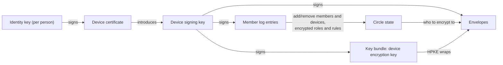

# Kinfold protocol, version 0

**Status:** draft 0.2, November 2026. Not stable: anything here may change before 1.0, and v0 makes no promise of compatibility with later versions.
**License:** [CC BY 4.0](https://creativecommons.org/licenses/by/4.0/). Test vectors: CC0 1.0.
**Labels:** every domain-separation label starts with `kinfold/v0/` (one constant in the reference implementation).

This document specifies the bytes that Kinfold apps, servers and web devices exchange: identities and devices, the circle member log, encrypted envelopes, payloads, invites, device linking, safety codes, share links and server login. The HTTP API that carries these objects is sketched separately in [API.md](API.md). Test vectors are in [vectors/kinfold-v0.json](vectors/kinfold-v0.json); a reference implementation is in `reference/python`.

---

## Contents

1. Introduction
2. Encoding
3. Cryptography
4. Accounts and devices
5. The member log: format
6. The member log: validation
7. Envelopes
8. Payloads
9. Invites and joining
10. Linking devices
11. Safety codes
12. Share links
13. Server identity and login
14. Silence watches and push (outline)
15. Security considerations
16. Registries
17. Test vectors and conformance
- Appendix A. Design decisions
- Appendix B. Open questions
- Appendix C. Implementation notes

---

## 1. Introduction

### 1.1 Goals

- **The server can't read what families share.** Locations, names, avatars, places, chat, roles, guardian relationships, teen rules and pauses are encrypted on the device.
- **The server can't change who is in a circle.** Membership lives in a hash-chained log of entries signed by members' devices. Phones encrypt only to devices that appear in a log they have verified.
- **Every device reaches the same conclusion.** Given the same log and the same keys, every honest client computes the same members, roles and rules, including for entries that break the rules.
- **Implementable with platform crypto.** Everything uses primitives available in CryptoKit (iOS 17+), Tink or the Android platform, Go's standard library and browser WebCrypto: X25519, Ed25519, HKDF-SHA-256, AES-256-GCM, SHA-256/512 and HPKE (RFC 9180) built from them.

### 1.2 What the server learns

The server sees: account IDs and identity public keys; device IDs, device kinds and public keys; which accounts are in which circle; **which members are circle admins** (§6.4 explains why this one flag is public); when membership changes and when a new key epoch starts; envelope sizes (padded to buckets), timing, sender device, recipient devices and time-to-live; silence-watch registrations; IP addresses at connection time.

The server never sees: positions, names, avatars, places, chat, check-ins, SOS details, the circle's name, who is a teen, who guards whom, teen rules, pauses, or the content of any policy change.

### 1.3 Conventions

The key words MUST, MUST NOT, SHOULD, SHOULD NOT and MAY are to be interpreted as described in BCP 14 (RFC 2119, RFC 8174) when, and only when, they appear in all capitals.

- **Account:** a person, identified by an identity key.
- **Device:** a phone, tablet, web browser or Home Assistant install acting for an account, with its own keys.
- **Circle:** a group of accounts sharing with each other, defined by its member log.
- **Client:** software on a device. **Server:** the family's Kinfold server.
- `‖` is byte concatenation. `x[a:b]` is bytes a (inclusive) to b (exclusive) of x.

### 1.4 Overview



---

## 2. Encoding

All structures are byte strings built by concatenating fields in order, with no padding and no tags.

| Notation | Meaning |
| --- | --- |
| `u8`, `u16`, `u32`, `u64` | Unsigned integers, big-endian |
| `bytes x[N]` | Exactly N bytes |
| `vec16 x` | `u16` length in bytes, then that many bytes |
| `vec32 x` | `u32` length in bytes, then that many bytes |
| `ids x` | A `vec16` holding 16-byte IDs; its length MUST be a multiple of 16 and the IDs MUST be strictly ascending (bytewise), so lists never contain duplicates |
| `flag x` | A `u8` that MUST be 0 or 1 |
| strings | UTF-8 inside a `vec16`, no terminator |

**Parsing.** A parser MUST reject input that ends before a field is complete, a length that runs past the end of the input, a `flag` other than 0 or 1, an `ids` list that is not a multiple of 16 bytes or not strictly ascending, and any bytes left over after the last field. These failures have the reason code `malformed`.

**Text forms.** Binary values shown to people or put in URLs use base64url without padding (RFC 4648 §5). Decoders MUST reject padding, characters outside `A–Z a–z 0–9 - _`, and non-canonical encodings (input whose re-encoding differs).

**Time.** Timestamps are `u64` milliseconds since 1970-01-01T00:00:00Z, ignoring leap seconds.

---

## 3. Cryptography

### 3.1 Cipher suite 0x0001

| Function | Algorithm |
| --- | --- |
| Signatures | Ed25519 (RFC 8032), pure mode. Private keys are 32-byte seeds |
| Key agreement | X25519 (RFC 7748). Private keys are 32 bytes, clamped by X25519 itself |
| Hash | SHA-256; SHA-512 for safety codes only |
| KDF | HKDF-SHA-256 (RFC 5869) |
| AEAD | AES-256-GCM, 12-byte nonce, 16-byte tag |
| Public-key encryption | HPKE (RFC 9180) base mode: KEM 0x0020 DHKEM(X25519, HKDF-SHA256), KDF 0x0001 HKDF-SHA256, AEAD 0x0002 AES-256-GCM |

Every structure carries `version = 0` and, where it matters, `suite = 0x0001`. A receiver MUST reject other values.

*Why AES-256-GCM:* browsers' WebCrypto offers AES-GCM but not ChaCha20-Poly1305, phones have AES hardware, and Apple's post-quantum HPKE suite (X-Wing) also uses AES-256-GCM.

### 3.2 Labels

Every hash, signature and derived key is bound to its purpose by an ASCII label of the form `kinfold/v0/<purpose>`. Section 16.4 lists them all. In this document, `"purpose"` in a function call means the full label `kinfold/v0/purpose`.

### 3.3 Hash, sign, derive

```text
H(label, data)           = SHA-256( vec16(label) ‖ data )
Sign(sk, label, data)    = Ed25519-Sign( sk, vec16(label) ‖ data )
Verify(pk, label, data, sig)
KDF(ikm, label, L)       = HKDF-Expand( HKDF-Extract(salt = 32 zero bytes, ikm), info = vec16(label), L )
```

`vec16(label)` is the label's length as a `u16` followed by its ASCII bytes; for `kinfold/v0/log-hash` that is `00 13` then 19 bytes. Truncated hashes such as `H(…)[0:16]` take the first bytes.

Ed25519 verification MUST reject signatures whose `S` is not below the group order (RFC 8032 §5.1.7). The vectors contain only canonical signatures; v0 does not otherwise pin down edge-case verification behaviour.

### 3.4 AEAD

`AEAD-Seal(key, nonce, plaintext, aad)` and `AEAD-Open(…)` are AES-256-GCM. Every key in this protocol is either used for exactly one message (with a derived nonce) or used with fresh random 12-byte nonces carried next to the ciphertext.

### 3.5 HPKE

All HPKE use is single-shot base mode with **empty `aad`**; context goes in `info`, which is always a 32-byte `H(…)` value. (Tink's public hybrid API exposes only `info`, called "context info", and RFC 9180 only guarantees `info` up to 64 bytes.)

```text
Seal(pk_R, info, pt)  -> enc (32 bytes), ct (len(pt) + 16 bytes)
Open(enc, sk_R, info, ct) -> pt or failure
```

The sender's ephemeral key MUST be fresh for every seal. Test vectors fix the ephemeral key by giving `ikmE`, from which RFC 9180 `DeriveKeyPair` produces it; platforms that can't inject an ephemeral key (CryptoKit, Tink, most others) skip the byte-exact "seal" checks and run the "open" checks, which are mandatory.

### 3.6 Randomness

Secrets, nonces and HPKE ephemeral keys MUST come from the platform's cryptographically secure random generator.

---

## 4. Accounts and devices

### 4.1 Keys

| Key | Type | Held by | Purpose |
| --- | --- | --- | --- |
| Identity key (IK) | Ed25519 | The person's phones and tablets | Vouches for the account's devices; its public half is the account's identity and the basis of safety codes |
| Device signing key (DSK) | Ed25519 | One device; never leaves it | Signs log entries, envelopes, key bundles and logins |
| Device encryption key (DEK) | X25519 | One device; rotated | Receives HPKE wraps |
| Server key | Ed25519 | The server | Signs the server's identity document and login challenges |

The first device creates the IK when the account is created. Linking a phone or tablet (§10) copies the IK to it over an encrypted channel, so any of a person's phones can add devices and replacing a phone doesn't change their safety code. Web and Home Assistant devices never receive the IK. Private keys are stored sealed by the phone's security chip where it has one (the Secure Enclave on iPhone; StrongBox or the TEE on Android), excluded from backups; this document only requires that they never leave the device except as stated here.

### 4.2 Identifiers

```text
account_id = H("account-id", ik_pub)[0:16]
device_id  = H("device-id",  dsk_pub)[0:16]
key_id     = H("key-id",     dek_pub)[0:8]
```

### 4.3 Device certificate

The account's IK states that a signing key belongs to one of its devices.

```text
struct DeviceCert {                 // 156 bytes
  u8    version = 0;
  u16   suite = 0x0001;
  bytes account_id[16];
  bytes dsk_pub[32];
  u8    device_kind;                // 1 phone, 2 tablet, 3 web, 4 home-assistant
  u64   issued_at;
  bytes ik_pub[32];
  bytes sig[64];                    // Sign(IK, "device-cert", the first 60 bytes)
}
```

A certificate is **valid** when `version` and `suite` are as shown, `device_kind` is in the registry (§16.3), `account_id == H("account-id", ik_pub)[0:16]`, and `sig` verifies under `ik_pub`. Its device ID is `H("device-id", dsk_pub)[0:16]`.

### 4.4 Key bundle

A device's DSK publishes its current encryption key.

```text
struct KeyBundle {                  // 147 bytes
  u8    version = 0;
  u16   suite = 0x0001;
  bytes account_id[16];
  bytes device_id[16];
  bytes dek_pub[32];
  u64   not_before;
  u64   not_after;
  bytes sig[64];                    // Sign(DSK, "key-bundle", the first 83 bytes)
}
```

A bundle is **valid for** a device (`dsk_pub`, `account_id`) when `version` and `suite` are as shown, `device_id == H("device-id", dsk_pub)[0:16]`, `account_id` matches, `not_before < not_after ≤ not_before + 35 days` (3,024,000,000 ms), and `sig` verifies under `dsk_pub`. Binding the account ID stops anyone from replaying a device's bundle under a different account.

### 4.5 Rotation and deletion

- A device SHOULD publish a new bundle (an `UPDATE_KEY` entry, §5.3, in every circle it belongs to) every 7 days, with `not_after = not_before + 14 days`.
- Senders always use the **current** bundle in the log, even if `not_after` has passed; a stale key only means the device has been offline. Clients MAY show "hasn't been online since …".
- A device MUST keep an old DEK private key until every envelope that could be wrapped to it has expired: at least 30 days (the longest envelope time-to-live) after the bundle that replaced it appeared. It SHOULD delete the key then. This bounds what a stolen phone can decrypt.

### 4.6 Wraps

A **wrap** carries a 32-byte secret to one device:

```text
struct Wrap {                       // 104 bytes
  bytes recipient_device_id[16];
  bytes key_id[8];                  // key_id of the recipient's current DEK
  bytes enc[32];                    // HPKE encapsulated key
  bytes ct[48];                     // HPKE ciphertext of the 32-byte secret
}
```

`enc, ct = Seal(dek_pub, info, secret)`, where `info` depends on the context (§5.6, §7.3). A list of wraps is a `vec32` whose length MUST be a multiple of 104 (else `malformed`); writers MUST sort wraps by `recipient_device_id`, and readers check that order where this document says so.

To open its wrap, a device finds the entry with its own device ID (none: `not_a_recipient`), looks up the private key for `key_id` (none: `unknown_key`), and opens it (failure, or a result that isn't 32 bytes: `bad_wrap`).

---

## 5. The member log: format

### 5.1 Model

Each circle has one append-only log. Entry 0 is `GENESIS`; each later entry names the hash of the one before it. The log has a public part, which the server can check, and an encrypted part — `details` — readable only by members.

Members share an **epoch secret** (32 random bytes). It encrypts the log's details. Epoch 0 starts at genesis. A `REKEY` by an admin, or an admin removing someone else's member or device, starts the next epoch, with the new secret wrapped to every remaining device. Any other removal — someone leaving, a device removing itself, or a non-admin removing a device — can't choose the next secret, because the person or device leaving would know it, and only admins create secrets; it marks a **rekey pending** instead, and no encrypted entry may be written until an admin rekeys (§6.4). Either way, a removed member can't read details added after they left. New members and devices receive all past epoch secrets when they join, so they can verify the whole log.

### 5.2 Entry

```text
struct LogEntry {
  // header: 88 bytes
  u8    version = 0;
  u16   suite = 0x0001;
  u8    entry_type;                 // §16.1
  bytes circle_id[16];              // all zero in GENESIS
  u64   seq;                        // 0 for GENESIS, then +1
  bytes prev_hash[32];              // all zero in GENESIS
  u64   created_at;
  bytes author_device_id[16];
  u32   epoch;                      // the circle's current epoch when written
  // ---
  vec32 body;                       // §5.3
  bytes sig[64];                    // Sign(author DSK, "log-entry", everything before sig)
}

entry_hash = H("log-hash", entire entry including sig)
circle_id  = H("circle-id", entire GENESIS entry)[0:16]
```

### 5.3 Entry types and bodies

| Code | Type | Body |
| --- | --- | --- |
| 0x01 | `GENESIS` | `DeviceCert founder_cert; KeyBundle founder_bundle; bytes epoch_commit[32]; vec32 details` |
| 0x02 | `ADD_MEMBER` | `DeviceCert cert; KeyBundle bundle; bytes invite_id[16]; bytes consent_sig[64]; flag admin; vec32 details` |
| 0x03 | `REMOVE_MEMBER` | `bytes account_id[16]; bytes epoch_commit[32]; vec32 wraps` |
| 0x04 | `ADD_DEVICE` | `DeviceCert cert; KeyBundle bundle` |
| 0x05 | `REMOVE_DEVICE` | `bytes device_id[16]; bytes epoch_commit[32]; vec32 wraps` |
| 0x06 | `UPDATE_KEY` | `KeyBundle bundle` |
| 0x07 | `POLICY` | `vec32 details` |
| 0x08 | `REKEY` | `bytes epoch_commit[32]; vec32 wraps` |
| 0x09 | `SET_ADMIN` | `bytes account_id[16]; flag admin` |

A body MUST be exactly as listed, with no bytes left over. A `details` field MUST be at least 28 bytes (a nonce and a tag). Both failures are `malformed`. In a removal that doesn't start an epoch (§6.4), `epoch_commit` is 32 zero bytes and `wraps` is empty.

- **ADD_MEMBER** adds one account with its first device. `invite_id` and `consent_sig` come from the join request (§9): `consent_sig = Sign(new member's IK, "join-consent", circle_id ‖ invite_id ‖ cert ‖ bundle)`, which proves the person asked to join *this* circle with *these* keys.
- **ADD_DEVICE** adds a device to the author's own account.
- **POLICY** changes encrypted state only: roles' rules, guardians, pauses, the circle's name (§5.5).
- **SET_ADMIN** grants or removes the admin flag.

### 5.4 Encrypted details

```text
log_key(e)       = KDF(epoch_secret_e, "log-key", 32)
details          = nonce[12] ‖ AEAD-Seal(log_key(entry.epoch), nonce, plaintext, aad = the entry's 88-byte header)
```

The nonce MUST be 12 fresh random bytes for every encryption. (A deterministic nonce would repeat when an append loses a race and is rebuilt at the same `seq`, §6.7.) The header as AAD binds the details to this exact position, author and epoch.

### 5.5 Private structures

These are the plaintexts inside `details`.

```text
struct GenesisDetails { vec16 circle_name; }            // UTF-8, 1–128 bytes

struct MemberDetails {
  u8    role;                       // 1 adult, 2 teen
  u64   teen_until;                 // teen: when teen settings may end (> created_at); adult: 0
  ids   guardians;                  // teen: at least one adult member; adult: empty
  Rules rules;                      // teen: initial rules; adult: any valid Rules, ignored
}

struct Rules {
  u8    pause_mode;                 // 0 never, 1 ask each time, 2 ask, or pause freely inside schedule windows
  u8    approx_mode;                // same values, for approximate location
  u16   speed_alert_kmh;            // 0 off, at most 300
  u8    phone_use_alerts;           // 0 or 1
  u8    history_days;               // 1–30
  u16   silence_alert_min;          // 0 off, at most 1440
  vec16 schedule;                   // 0–32 Window structs, 6 bytes each
}
struct Window {
  u8    kind;                       // 1 pause allowed, 2 approximate allowed
  u8    days;                       // bit 0 Monday … bit 6 Sunday; 1–127
  u16   start_min;                  // minutes after local midnight on the teen's device
  u16   end_min;                    // start_min < end_min ≤ 1440
}

struct Policy {
  u8 subtype;                       // §16.2
  select (subtype) {
    case SET_RULES:       bytes target[16]; Rules rules;
    case SET_GUARDIANS:   bytes target[16]; ids guardians;
    case GRANT_PAUSE:     bytes target[16]; bytes pause_id[8]; u8 kind; u64 start; u64 end;
    case REVOKE_PAUSE:    bytes target[16]; bytes pause_id[8];
    case END_TEEN:        bytes target[16];
    case SET_CIRCLE_NAME: vec16 name;   // UTF-8, 1–128 bytes
  }
}
```

`Rules` is **valid** when every field is within the ranges in the comments. Defaults for a new teen: pause_mode 1, approx_mode 1, speed off, phone-use alerts off, 7 days of history, silence alert after 60 minutes, no schedule. A window crossing midnight is written as two windows. In `GRANT_PAUSE`, kind 1 pauses sharing (heartbeats only) and kind 2 allows approximate location; `pause_id` is the teen's request ID (§8.4).

### 5.6 Epochs and epoch wraps

```text
epoch_commit = H("epoch-commit", u32(epoch) ‖ epoch_secret)
```

`GENESIS` commits to epoch 0. A `REKEY`, and a removal by an admin who stays in the circle (§6.4), start epoch `n + 1` (where `n` is the entry's `epoch` field), commit to its secret, and carry one wrap of the new secret for **every device active after the entry**, using that device's current key:

```text
info = H("epoch-wrap", circle_id ‖ u64(seq) ‖ prev_hash ‖ u32(n + 1) ‖ recipient_device_id ‖ key_id)
```

where `circle_id`, `seq` and `prev_hash` are this entry's. A recipient MUST check that the opened secret matches `epoch_commit`; if its wrap fails to open or the secret doesn't match, the device is **locked out** of that epoch: it follows §6.5's rule for missing secrets and asks another member's device for a `refresh` (§8.5). The commitment also guarantees that every member received the same secret.

---

## 6. The member log: validation

### 6.1 State

A circle's state after an entry is:

- `circle_id`, `seq`, `head` (hash of the last entry), the set of all entry hashes, `epoch`, the commitment for each epoch, and `rekey_pending`.
- **Members**, by account ID, each with: identity public key; `admin` flag; devices (device ID, DSK public key, kind, current key bundle). *(Public.)*
- Per member, private: `role` (adult or teen), `teen_until`, `guardians`, `rules` (teens only), and stored `pauses` (`pause_id` → kind, start, end; granted and not revoked, whether or not in force). The circle's `name`. A list of **flags**: `(seq, reason)` for every rejected entry and every entry accepted with unreadable details. `private_unknown_from`: the `seq` from which this client couldn't run the private rules (§6.5), normally none.

An **active device** is a device of a current member. A **current admin** is a member whose admin flag is set.

### 6.2 Outcomes

Each entry has exactly one outcome:

| Outcome | Meaning | Who can tell |
| --- | --- | --- |
| **fatal** | The log is broken at this entry. A server MUST refuse to append it. A client that receives it MUST NOT apply it or anything after it, and MUST tell the person the circle's history can't be verified. | Server and clients |
| **accepted** | Applied. | Server and clients |
| **accepted, flagged `bad_details`** | Public effects applied; the encrypted details were unreadable or invalid, so a default is used (§6.5). | Clients |
| **rejected** | Only `POLICY` entries can be rejected. The entry stays in the chain (its hash becomes the head) but changes nothing else, and is flagged. | Clients |
| **deferred** | The client lacks the epoch secret for this entry's details, or its private state is already frozen (§6.5): public effects applied, private rules wait for the secret. | Clients |

Every fatal reason is detectable from public data, so an honest server never stores a fatal entry; seeing one means the server misbehaved. Everything that depends on encrypted data can only *reject* or *flag*, never break the chain, so a misbehaving member can't lock a family out of its own circle. All honest clients holding the same epoch secrets reach the same outcome for every entry; one missing a secret defers instead (§6.5) and catches up when the secret arrives.

A server runs §6.3 steps 1–8 and applies the public effects in step 10 ("public mode"); a client runs all of it. Servers also check `created_at` against their own clock (§6.7); the vectors leave that check out because it depends on the clock (one vector entry is dated 2031).

### 6.3 Processing order

To process an entry, perform these checks in order; the first failure determines the outcome and reason code.

1. Parse the entry framing (§5.2): header, `vec32 body`, 64-byte signature, nothing left over. → fatal `malformed`
2. `version == 0` and `suite == 0x0001`. → fatal `bad_version`
3. `entry_type` is in §16.1. → fatal `unknown_entry_type`
4. Parse the body for its type (§5.3), including the certificates, bundles and wrap lists inside it. → fatal `malformed`
5. Position. If the log is empty: the entry MUST be `GENESIS` and its `seq` 0 (either failure → `bad_seq`), `prev_hash` all zero (→ `bad_prev_hash`), `circle_id` all zero (→ `bad_circle_id`) and `epoch` 0 (→ `bad_epoch`). Otherwise: not `GENESIS` (→ `unexpected_genesis`), `seq` = previous `seq` + 1 (→ `bad_seq`), `prev_hash` = current head (→ `bad_prev_hash`), `circle_id` matches (→ `bad_circle_id`), `epoch` = current epoch (→ `bad_epoch`). All fatal.
6. Author. In `GENESIS`, `author_device_id` MUST equal the founder certificate's device ID (→ fatal `bad_author`) and the author's key is that certificate's `dsk_pub`. Otherwise the author MUST be an active device (→ fatal `author_not_active`).
7. `sig` verifies under the author's DSK. → fatal `bad_signature`
8. The type's public rules (§6.4), in the order listed. → fatal, with the reason shown.
9. *(Clients.)* The type's private rules (§6.5).
10. Apply the entry's effects, set `seq` and `head`, then *(clients)* run guardian repair (§6.6).

### 6.4 Public rules

"The author" means the author device's account.

**GENESIS** — `founder_cert` is valid (`bad_cert`); `founder_bundle` is valid for it (`bad_bundle`). *Effect:* `circle_id` is computed (§5.2); the founder becomes the only member, an admin, with one device; epoch 0's commitment is recorded.

**ADD_MEMBER** — the author is an admin (`not_admin`); no rekey is pending (`rekey_pending`); `cert` is valid (`bad_cert`); `bundle` is valid for `cert`'s device and account (`bad_bundle`); `cert.account_id` is not a current member (`already_member`); `cert`'s device is not an active device (`device_active`); `consent_sig` verifies under `cert.ik_pub` over `circle_id ‖ invite_id ‖ cert ‖ bundle` (`bad_consent`). *Effect:* the account becomes a member, admin if `admin` is 1, with one device.

**REMOVE_MEMBER** — `account_id` is a current member (`not_member`); the author is an admin, or is that account (`not_admin`); if the target is an admin and the only one, it is also the only member (`last_admin`). If the author is an admin and not the target, the wraps (below) cover every device of the remaining members (`bad_wraps`), the epoch advances and any pending rekey is cleared; otherwise `epoch_commit` is all zero and there are no wraps (`bad_wraps`), and the circle is marked rekey pending. *Effect:* the member and their devices are removed.

**ADD_DEVICE** — `cert` is valid (`bad_cert`); `cert.account_id` is the author's account and `cert.ik_pub` is that member's identity key (`wrong_account`); `bundle` is valid for `cert`'s device and account (`bad_bundle`); the device is not already active (`device_active`). *Effect:* the device is added to the author's account.

**REMOVE_DEVICE** — `device_id` is an active device (`unknown_device`); it belongs to the author's account, or the author is an admin (`not_admin`); it is not its account's only device — remove the member instead (`last_device`). If the author is an admin writing from a device other than the one being removed, the wraps cover every other active device (`bad_wraps`), the epoch advances and any pending rekey is cleared; otherwise `epoch_commit` is all zero and there are no wraps (`bad_wraps`), and the circle is marked rekey pending. *Effect:* the device is removed.

**UPDATE_KEY** — `bundle` is valid for the author device and its account, and its `key_id` differs from the device's current one (`bad_bundle`). *Effect:* the bundle becomes the device's current key.

**POLICY** — no rekey is pending (`rekey_pending`). Its effect is private (§6.5).

**REKEY** — the author is an admin (`not_admin`); the wraps cover every active device (`bad_wraps`). *Effect:* the epoch advances and any pending rekey is cleared.

**Who creates epoch secrets.** Only an admin who stays in the circle. A member who leaves or removes their own device would know any secret they created, so their removal starts no epoch; and since only the recipient can tell whether a wrap opens, limiting who hands out wraps limits who could hand out ones that don't. While a rekey is pending, `ADD_MEMBER` and `POLICY` entries are refused; every admin device that sees the flag SHOULD append a `REKEY` after a random delay of up to a minute (the append conflict of §6.7 lets only one through). The cost: until an admin's device is online, guardians can't change rules or grant pauses either (Appendix B).

**SET_ADMIN** — the author is an admin (`not_admin`); `account_id` is a current member (`not_member`); the entry doesn't remove the admin flag from the only admin (`last_admin`). *Effect:* the flag is set to `admin`.

**Wrap coverage** (`bad_wraps`): the wraps are strictly ascending by device ID, there is exactly one for each device in the required set and none for any other device, and each wrap's `key_id` is the key ID of that device's current bundle. The server can check all of this; only the recipient can check that its own wrap opens (§5.6).

**Why the admin flag is public.** Membership changes have public effects: the server must stop serving a removed member, and an ex-partner who has been removed shouldn't keep seeing even the timing of the family's updates. If the right to add or remove people depended on encrypted data, the server couldn't tell a real removal from a forged one, and the server's view of the circle could drift from the members' view. So every entry with a public effect is decided by public rules only, and the single fact that requires — who is an admin — is public. Teen status, guardianship and rules stay private, and only `POLICY` entries depend on them. Two consequences follow, both deliberate:

- **Anyone can leave.** A self-removal is valid for every member, including a teen, and leaves a rekey pending. The one exception is the only admin while others remain, who must first make someone else an admin (`last_admin`). When the last member leaves, the circle is closed: with no active devices no entry can follow, and the server MAY delete it. The protocol can't stop a phone from going silent anyway; what it guarantees is that leaving is visible. The app offers teens "Ask to leave" rather than "Leave", and when a teen's self-removal appears, every client MUST show it to the teen's guardians (§6.8).
- **Admin is a public permission, not a role.** The protocol lets an admin make any member an admin; apps offer it only for adults.

### 6.5 Private rules (clients)

Clients normally hold every epoch secret up to the current one (from joining, wraps or a `refresh`) and use `key = log_key(entry.epoch)`.

**Missing secrets.** A secret counts only if it matches the log's `epoch_commit`; a client MUST discard one that doesn't. Only entries with details — `GENESIS`, `ADD_MEMBER` and `POLICY` — need their epoch's secret. A client that lacks it for such an entry MUST apply only the public effects of that entry and every later one (their outcome is **deferred**), MUST treat its private state (roles, guardians, rules, pauses, the circle's name) as unknown from that entry on, and MUST NOT author `POLICY` or `ADD_MEMBER` entries or enforce teen rules from it. Once it obtains the secret, it runs the private rules again from that entry, in order. This keeps every client's private state identical: a missing secret never produces `bad_details`. In the vectors, a frozen state has `private_unknown_from` set to the first such `seq`, and its private fields keep their last known values.

**Failures inside details.** Any structural failure while parsing details — a length, an `ids` list out of order, a `flag` out of range, a `schedule` whose length isn't a multiple of 6, bytes left over — is `bad_details`. The other reasons below are for values that parse but break a rule.

**GENESIS** — open `details`, parse `GenesisDetails`, check the name. If any step fails, the circle's name is empty and the entry is flagged `bad_details` (still accepted). The client MUST check `epoch_commit` against the epoch-0 secret it was given.

**ADD_MEMBER** — open `details` and parse `MemberDetails`. The details are valid when either

- `role` is 1 (adult), `teen_until` is 0, `guardians` is empty and `rules` is valid; or
- `role` is 2 (teen), `teen_until > created_at`, `guardians` is non-empty, every guardian is a current member whose role is adult (the new member doesn't count), and `rules` is valid.

If valid, the new member gets that role, `teen_until`, guardians and (for teens) rules. Otherwise the member is added as an **adult** and the entry is flagged `bad_details`. This is the only way teen status is ever set: it can't be applied to an existing member.

**POLICY** — checks in order; the first failure rejects the entry with the reason shown:

1. `details` opens and parses as `Policy` (for a known subtype, nothing left over). → `bad_details`
2. `subtype` is in §16.2; an unknown subtype is not parsed further. → `unknown_policy`
3. `SET_CIRCLE_NAME`: the author is an admin (→ `not_admin`) and the name is 1–128 bytes of valid UTF-8 (→ `bad_details`). *Effect:* the circle's name changes. Stop here.
4. `target` is a current member (→ `not_member`) whose role is teen (→ `not_teen`).
5. `END_TEEN`: the author must be one of the target's guardians; or the target themselves, provided `created_at ≥ teen_until` (→ `teen_until_not_reached`); anyone else → `not_guardian`. *Effect:* the target becomes an adult; `teen_until`, guardians, rules and pauses are cleared. Stop here.
6. The author is one of the target's guardians. → `not_guardian`
7. By subtype:
   - `SET_RULES`: `rules` is valid (→ `bad_rules`). *Effect:* the rules are replaced.
   - `SET_GUARDIANS`: the list is non-empty and every entry is a current adult member (→ `bad_guardians`). *Effect:* the guardians are replaced.
   - `GRANT_PAUSE`: `kind` is 1 or 2, `start < end ≤ start + 24 hours` (86,400,000 ms), and `pause_id` is not one of the target's stored pauses (→ `bad_pause`). *Effect:* the pause is added.
   - `REVOKE_PAUSE`: `pause_id` is one of the target's stored pauses (→ `unknown_pause`). *Effect:* it is removed.

`created_at` is the author's clock, checked by the server to within 10 minutes (§6.7), which is why a teen can end their own teen settings only once `teen_until` has passed by that clock. A pause is in force while `start ≤ now < end` on the teen's device; expired pauses stay in the state until revoked and have no effect.

### 6.6 Guardian repair

After applying every non-fatal entry, clients visit each teen in ascending account-ID order:

1. Drop from their guardians anyone who is no longer a member or no longer an adult.
2. If none remain, their guardians become every current member who is an adult **and** an admin, in ascending order.
3. If there are still none, every current adult member.
4. If there are still none, the teen's teen settings end, as with `END_TEEN`.

This keeps the rule "a teen always has at least one guardian" true even when the last guardian leaves, which the protocol can't prevent (§6.4). Apps SHOULD make a guardian hand over guardianship before leaving, so repair is a fallback.

### 6.7 Appending

- To append, a client builds the entry on the head it knows and posts it. The server MUST check §6.3 steps 1–8 and that `created_at` is within 10 minutes of its own clock (`bad_time`), and MUST append entries one at a time. If the head has moved, the server answers with a conflict; the client fetches the new entries, validates them, re-checks that its change still makes sense, and rebuilds its entry from scratch — new `seq`, `prev_hash`, details nonce, wraps and signature.
- A client MUST validate entries it authors with the full rules before posting. Honest clients never author fatal entries, and SHOULD NOT author entries they know will be rejected.
- Clients MUST keep the highest `seq` and head they have verified and MUST NOT accept a log that is shorter or that diverges from it (rollback protection).
- A new member's welcome (§8.5) carries the head it was sent at; the joining device fetches and verifies the log from genesis to at least that head.

### 6.8 Alerts

Everyone is told when the circle changes; that is part of the protocol, not an app nicety. A client MUST show, to every member:

- a member added or leaving or removed; a device added or removed; a safety code that changed because a member's identity key changed (a new account for the same person);
- for teens' guardians in particular: a teen leaving on their own, a teen's new device, guardianship changes, and teen settings ending.

Clients SHOULD show admins any rejected or flagged entry ("Maya tried to change her own rules").

---

## 7. Envelopes

An envelope carries one encrypted payload from one device to some devices of a circle.

### 7.1 Structure

```text
struct EnvelopeHeader {             // 88 bytes
  u8    version = 0;
  u16   suite = 0x0001;
  u8    kind;                       // 1 circle (everyone), 2 direct (chosen devices)
  bytes circle_id[16];
  bytes sender_device_id[16];
  u64   seq;                        // per sender device and circle; strictly increasing; starts at 1
  u64   sent_at;
  u32   ttl_s;                      // seconds the server keeps it: 60 to 2,592,000 (30 days)
  bytes log_head[32];               // the sender's verified log head
}

struct Envelope {
  EnvelopeHeader header;
  vec32 wraps;                      // Wrap structs (§4.6), strictly ascending by device ID
  vec32 ciphertext;
  bytes sig[64];                    // Sign(sender DSK, "envelope", everything before sig)
}
```

### 7.2 Recipients

- **kind 1 (circle):** every active device at `log_head` except the sender device itself — including the sender's other devices.
- **kind 2 (direct):** any non-empty set of active devices, for example a teen's guardians' devices, one member's devices, or a newly joined device.

A sender MUST use only devices from a log it has verified and each device's current key. Receivers SHOULD warn when a circle envelope omits devices it should include, but MUST NOT reject it for that reason, since the receiver's head may differ from the sender's.

### 7.3 Encryption

```text
message_secret = 32 random bytes, new for every envelope
wrap info      = H("wrap", header ‖ recipient_device_id ‖ key_id)
payload_key    = KDF(message_secret, "payload-key", 32)
payload_nonce  = KDF(message_secret, "payload-nonce", 12)
aad            = H("env-aad", header ‖ vec32(wraps))      // the envelope's bytes up to the end of wraps
ciphertext     = AEAD-Seal(payload_key, payload_nonce, Pad(payload), aad)
```

Each wrap seals `message_secret` (§4.6). Because `message_secret` is used for one envelope only, the derived nonce is safe.

### 7.4 Padding

Padding hides the payload's type and size. The buckets are 256, 512, 1024, 2048, 4096, 8192, 16384 and 65536 bytes; payloads may be at most 65,535 bytes.

```text
Pad(p)   = p ‖ 0x80 ‖ zero bytes, to the smallest bucket ≥ len(p) + 1
Unpad(x) = len(x) MUST be a bucket size; strip trailing 0x00 bytes; the last byte left MUST be 0x80; remove it
```

### 7.5 Sending

The sender builds the header, wraps, ciphertext and signature in that order and posts the envelope. Before storing it, the server runs §7.6 steps 1–10 with its own clock (it holds the whole log, so step 5 needs no fetch), then checks that every wrap names an active device (→ `bad_wraps`) and that `ttl_s` is in range (→ `bad_ttl`), and applies its size and rate limits. It records `(sender_device_id, seq)` for its own replay check when it stores the envelope, and keeps the envelope until `ttl_s` has passed and delivers it to the devices named in the wraps. It never needs to understand the payload.

### 7.6 Receiving

A receiver with a verified log runs these checks in order; the first failure discards the envelope with the reason shown.

1. Parse (§7.1, wraps length a multiple of 104, nothing left over). → `malformed`
2. `version == 0`, `suite == 0x0001`. → `bad_version`
3. `kind` is 1 or 2. → `bad_kind`
4. `circle_id` is this circle. → `wrong_circle`
5. `log_head` is an entry hash in the receiver's log; if not, fetch new log entries first and look again. → `unknown_log_head` (see §7.7)
6. The sender is an active device **at the receiver's current head**. → `sender_not_active`
7. `sig` verifies under the sender's DSK. → `bad_signature`
8. `sent_at` is no more than 31 days (2,678,400,000 ms) before the receiver's clock (→ `expired`) and no more than 1 day after it (→ `bad_time`).
9. `(sender_device_id, seq)` has not been accepted before in this circle. → `replay`
10. The wraps are non-empty and strictly ascending by device ID. → `bad_wraps`
11. Open the receiver's own wrap (§4.6). → `not_a_recipient`, `unknown_key` or `bad_wrap`
12. Derive the payload key and nonce; open the ciphertext. → `bad_ciphertext`
13. Unpad. → `bad_padding`
14. Parse the payload: UTF-8 JSON whose top level is an object with a string `"t"`. → `bad_payload`

Only after all of these succeed does the receiver record `(sender_device_id, seq)` and act on the payload. It MUST remember each recorded pair for at least 31 days after the envelope's `sent_at`; with step 8, that bounds the replay record to about 32 days of envelopes without ever letting an old one back in. A receiver MUST NOT let an envelope with a lower `seq` replace state set by a higher one from the same sender (for example a newer position); older envelopes can still fill in history.

### 7.7 Detecting a forked log

A malicious server could show different members different logs — for example, hide a removal from some phones so they keep encrypting to the removed person. `log_head` exposes this: if, after fetching everything the server offers, an envelope's `log_head` is still unknown, the sender and receiver have seen different histories. The receiver MUST then stop sending to the circle and tell the person that the server may be tampering with the circle, with an option to compare safety codes and log heads in person.

---

## 8. Payloads

### 8.1 Rules

- A payload is a JSON object (RFC 8259) in UTF-8 with a string field `"t"` naming its type. Senders SHOULD write compact JSON.
- Receivers MUST ignore fields they don't know, and MUST ignore payloads whose type they don't know.
- Positions are integers in units of 10⁻⁷ degree (`lat`, `lon`). Distances are metres, speeds centimetres per second, times milliseconds since the epoch. Binary values are base64url (§2).
- A routine location update SHOULD fit the 256-byte bucket.

### 8.2 Types

| `t` | Kind | Sent by | Fields |
| --- | --- | --- | --- |
| `loc` | circle | anyone | `ts`, `lat`, `lon`, `acc`, `prec` (`"exact"` or `"approx"`), optional `alt`, `spd`, `hdg` (degrees), `bat` (0–100), `chg` (bool), `act` (`"still"`, `"walk"`, `"run"`, `"cycle"`, `"drive"`), `mock` (bool) |
| `hb` | circle | anyone | Heartbeat with no position: `ts`, `state` (`"sharing"`, `"paused"`, `"approx"`, `"loc_off"`, `"perm_low"`, `"saver"`), optional `bat`, `chg`, `pause_id` |
| `evt` | circle | anyone | Something to alert on: `ts`, `k` (`"arrive"`, `"leave"`, `"drive_start"`, `"drive_end"`, `"loc_off"`, `"perm_low"`, `"mock"`, `"saver_on"`, `"saver_off"`, `"resume"`), optional `place`, `detail` |
| `sig` | direct | anyone | Short control signal: `k` (`"live_req"`, `"live_end"`), optional `until` |
| `checkin` | circle | anyone | `ts`, `lat`, `lon`, `acc`, optional `place`, `note` |
| `sos` | circle | anyone | `ts`, `state` (`"start"`, `"update"`, `"cancel"`), `lat`, `lon`, `acc`, optional `note`. Always exact, even while paused |
| `place` | circle | anyone | `id` (8 random bytes), `v` (version, integer), `name`, `lat`, `lon`, `r` (radius, m), optional `del` (true deletes) |
| `profile` | circle | anyone | `name`, optional `color`, `avatar` (WebP, at most 32 KB), `devices` (object: device ID in base64url → device name) |
| `chat` | circle | anyone | `id` (8 random bytes), `text`, optional `reply_to` |
| `pause_req` | direct | teen | To the teen's guardians' devices and the teen's other devices: `id` (8 random bytes; becomes `pause_id`), `kind` (1 pause, 2 approximate), `start`, `end`, optional `note` |
| `pause_deny` | direct | guardian | To the teen and the other guardians: `id`, optional `note` |
| `welcome` | direct | admin | To a newly added member's or device's devices: `epochs` (array of base64url epoch secrets, index = epoch), `head` (base64url entry hash) |
| `refresh` | direct | anyone | Same fields as `welcome`, sent to a locked-out device (§5.6) |

### 8.3 Approximate positions

A device sharing approximately MUST snap the position to the centre of a fixed grid cell, never add random noise (averaging many noisy positions recovers the real one). With `c = 200000` (0.02°):

```text
lat' = floor(min(lat, 899999999) / c) · c + c/2
lon' = floor(lon* / c) · c + c/2     where lon* = lon − 3600000000 if lon ≥ 1800000000, else lon
```

`floor` is floor division (rounding toward −∞, which matters for negative coordinates). It sets `prec` to `"approx"` and `acc` to at least 2000.

### 8.4 Pausing (teens)

1. The teen's phone sends `pause_req` (direct) to the guardians' devices and the teen's other devices.
2. A guardian approves with a `GRANT_PAUSE` entry whose `pause_id` is the request's `id`, or declines with `pause_deny`.
3. The teen's phone verifies the entry through the log, pauses from `start` to `end`, and sends `hb` heartbeats with `state` `"paused"` and the `pause_id` meanwhile, so silence alerts keep working.
4. Inside a schedule window (`pause_mode` 2), the teen's phone may pause without asking; its heartbeats say `"paused"` with no `pause_id`.

Adults pause on their own: their phones simply send `hb` with `state` `"paused"`.

### 8.5 Welcome and refresh

After appending `ADD_MEMBER` or `ADD_DEVICE`, the author SHOULD send `welcome` to the new devices. The receiver MUST check each secret against the log's `epoch_commit` values before using it, discarding any that doesn't match (§6.5), and MUST check that the head is in the log. A `refresh` follows the same rules and MUST be ignored unless the receiver is actually locked out.

### 8.6 Persistent data

Envelopes expire, so data that should outlive them is re-sent:

- each device re-sends its member's latest `profile` whenever a member or device is added, and at least every 7 days;
- the device that added a member or device re-sends every current `place`; and
- for places, the highest `v` wins; ties go to the higher sender device ID, compared bytewise.

A server-side store for long-lived encrypted objects is planned (Appendix B).

---

## 9. Invites and joining

### 9.1 The invite

An admin's device creates a 16-byte random `secret` and shares this structure as a QR code or link:

```text
struct Invite {
  u8    version = 0;
  vec16 server_url;                 // https URL, no trailing slash
  bytes server_key[32];             // the server's identity key (§13): no trust on first use
  bytes circle_id[16];
  bytes secret[16];
  bytes inviter_ik_pub[32];
  u8    role_hint;                  // 1 adult, 2 teen: shown to the invitee before they join
  u64   expires_at;
  vec16 reg_token;                  // opaque server registration token; may be empty
}

invite_id = H("invite-id", secret)[0:16]
join_key  = KDF(secret, "join-key", 32)
links     = "kinfold://join/" ‖ b64u(Invite)   and   server_url ‖ "/join#" ‖ b64u(Invite)
```

The web form keeps the invite after `#`, so it never reaches a server in a request. The inviter registers `invite_id` and `expires_at` with the server, which then holds join requests for it.

### 9.2 Join request

The invitee verifies the server against `server_key` (§13), registers with `reg_token` if it has no account there, and posts:

```text
struct JoinRequest {
  u8    version = 0;
  bytes invite_id[16];
  bytes nonce[12];                  // random
  vec32 ct;                         // AEAD-Seal(join_key, nonce, plaintext, aad = the first 17 bytes)
}
plaintext   = DeviceCert cert ‖ KeyBundle bundle ‖ bytes consent_sig[64] ‖ vec16 name
consent_sig = Sign(invitee IK, "join-consent", circle_id ‖ invite_id ‖ cert ‖ bundle)
```

The server sees only the invite ID and ciphertext. The inviter's device decrypts, checks the certificate and bundle and the consent signature, and shows the name with the **safety code** between inviter and invitee (§11). Only after the person taps Allow — ideally after comparing codes — does it append `ADD_MEMBER` with the role, guardians and rules it chooses (the role SHOULD match `role_hint`), then send `welcome`. A leaked invite therefore can't add a stranger silently. The invite is single-use: after the add, or at `expires_at`, the server deletes it.

The new member's client MUST check that the log's genesis hash gives the invite's `circle_id`, that the `ADD_MEMBER` adding it was authored by a device of `inviter_ik_pub`'s account, and that its own role matches `role_hint`; if the role differs, it MUST say so and offer to leave.

---

## 10. Linking devices

A person adds a phone, tablet, web browser or Home Assistant install to their account. Either device can show the QR code:

- **Direction 1 — the existing phone shows it** and the new device scans it (adding a phone or tablet).
- **Direction 2 — the new device shows it** and the existing phone scans it (the web companion, which shows a QR in the browser).

```text
struct Link {
  u8    version = 0;
  u8    direction;                  // 1 shown by an existing device, 2 shown by the new device
  vec16 server_url;
  bytes server_key[32];
  bytes secret[16];
  u64   expires_at;
  // direction 1 only:
  bytes account_id[16];
  bytes ik_pub[32];
}

link_id      = H("link-id", secret)[0:16]
link_key     = KDF(secret, "link-key", 32)
link_confirm = KDF(secret, "link-confirm", 16)
app link     = "kinfold://link/" ‖ b64u(Link)
```

Messages go through a mailbox on the server addressed by `link_id`:

```text
struct LinkMessage {                // offer (type 1) and request (type 2)
  u8    version = 0;
  bytes link_id[16];
  u8    msg_type;
  bytes nonce[12];
  vec32 ct;                         // AEAD-Seal(link_key, nonce, plaintext, aad = the first 18 bytes)
}
offer plaintext   = account_id[16] ‖ ik_pub[32]
request plaintext = dsk_pub[32] ‖ u8 device_kind ‖ KeyBundle bundle ‖ vec16 device_name
code              = u32(H("link-code", link_id ‖ request plaintext)[0:4]) mod 1,000,000, as 6 digits
```

1. *(Direction 2 only.)* The existing device posts an **offer** with its account ID and identity key.
2. The new device creates its DSK and DEK, signs a bundle for the account, and posts a **request**.
3. Both devices show the 6-digit code. After the person confirms it matches on the existing device, that device signs a certificate for the new device and appends `ADD_DEVICE` (with the request's bundle) to every circle the account belongs to.
4. It posts a **response**:

```text
struct LinkResponse {
  u8        version = 0;
  bytes     link_id[16];
  DeviceCert sender_cert;           // the existing device
  bytes     enc[32];
  vec32     ct;                     // HPKE Seal to the new device's DEK, info = H("link-info", link_id ‖ new_device_id)
  bytes     sig[64];                // Sign(sender DSK, "link-response", everything before sig)
}
plaintext = JSON {
  "cert":    b64u(the new device's DeviceCert),
  "ik":      b64u(IK seed),           // phones and tablets only; never for web or Home Assistant
  "confirm": b64u(link_confirm),
  "circles": [ { "id": b64u(circle_id), "epochs": [ b64u(secret_0), b64u(secret_1), … ] }, … ]
}                                   // epochs: every epoch from 0 to the circle's current one, in order
```

The new device checks that `sender_cert` is valid and carries the expected identity key (from the QR in direction 1, from the offer in direction 2), the signature, `confirm` (proving the sender saw the QR), that `cert` is for its own DSK, kind and account, and — if `ik` is present — that it derives that identity key. It then fetches each circle's log, finds its `ADD_DEVICE` entry and checks each epoch secret against the log, discarding any that doesn't match (§6.5). Offers, requests and responses are told apart by the mailbox slot they are posted to (API.md), which is why the response carries no `msg_type`.

---

## 11. Safety codes

Two people compare a 30-digit code or scan each other's QR to confirm that neither identity key was swapped.

```text
half(ik_pub):
  h = vec16("kinfold/v0/safety") ‖ ik_pub
  repeat 5200 times:  h = SHA-512(h ‖ ik_pub)
  for i in 0, 5, 10:  the 5 bytes h[i:i+5] as a big-endian integer, mod 100000, as 5 digits
  → 15 digits

code(a, b) = half(lower key) ‖ half(higher key)     // keys compared bytewise; the same for both people
             shown as six groups of five digits separated by single spaces
QR         = "kinfold://verify/" ‖ b64u(u8(0) ‖ lower key ‖ higher key)
```

Each half is the same in every circle, so a person's half changes only when their identity key does. The 5200 iterations make a matching fake key about 2¹² times more expensive to search for. Scanning compares the full keys and is preferred.

---

## 12. Share links

A member shares a live location with someone who doesn't have the app. The key stays in the URL fragment.

```text
secret    = 16 random bytes
link_id   = H("share-id", secret)[0:16]
share_key = KDF(secret, "share-key", 32)
url       = server_url ‖ "/s/" ‖ b64u(link_id) ‖ "#" ‖ b64u(secret)

struct ShareUpdate {
  u8    version = 0;
  bytes link_id[16];
  u64   seq;                        // increasing
  u64   expires_at;
  bytes nonce[12];                  // random
  vec32 ct;                         // AEAD-Seal(share_key, nonce, Pad(payload), aad = the first 33 bytes)
}
```

The payload is a `loc` object (§8.2) plus an optional `name`. The viewer page computes `link_id` from the fragment itself, ignores updates whose `seq` isn't higher than the last one shown, and shows "ended" after `expires_at`. Only the creating device may post updates (the server checks its login); deleting the link on the server ends it at once.

---

## 13. Server identity and login

### 13.1 Server identity

```text
struct ServerInfo {
  u8    version = 0;
  vec16 server_url;
  bytes server_key[32];
  u64   issued_at;
  u64   expires_at;
  bytes sig[64];                    // Sign(server key, "server-info", everything before sig)
}
```

`GET /.well-known/kinfold` returns it (base64url, inside a JSON document; see API.md). A client MUST check it against the server key it already trusts — from an invite or link, or pinned at first setup — and that `server_url` is the URL it used. A different key means a different server: the client MUST refuse to continue and say so. (Rotating the server key is an open question, Appendix B.)

### 13.2 Login

```text
1. client → server   device_id
2. server → client   challenge (32 random bytes), expires_at,
                     challenge_sig = Sign(server key, "auth-challenge", challenge ‖ device_id ‖ u64(expires_at))
3. client            checks challenge_sig against the trusted server key
4. client → server   device_sig = Sign(DSK, "auth", server_key ‖ challenge ‖ device_id)
5. server → client   a short-lived session token
```

Including `server_key` stops a malicious server from relaying a device's login signature to a different server. The server accepts logins only from devices registered with it; a device removed from a circle loses access to that circle's log, envelopes and mailboxes at once.

---

## 14. Silence watches and push (outline)

These need a server-visible relationship but no new cryptography; the full design comes with the API.

- **Silence watch.** A guardian's device asks the server: "tell me if account X's devices in circle C send nothing for N minutes" (`PUT /v1/circles/{id}/watches/{account}`). The server tracks only arrival times. Its alert is a push sealed to the watching device with HPKE (`info = H("push", device_id ‖ key_id)`) carrying `{circle_id, account_id, last_seen_at}`; names are filled in from the watcher's own records. For teens, guardians' apps register watches automatically (`silence_alert_min`); for adults, only with their consent.
- **iOS push relay.** A tiny stateless service run by the project forwards wake-ups to Apple. The app registers its APNs token with the relay and receives an opaque capability (the token sealed under a key only the relay holds), which it gives to its own server; the server hands the relay the capability plus an encrypted, padded payload. The relay stores nothing and can't read payloads.

---

## 15. Security considerations

- **Server compromise.** A malicious server can drop, delay or reorder envelopes and refuse appends, but can't forge entries (signatures), add a device to an account (identity-key signature), add a member (admin's signature plus the invitee's consent), read details or payloads, or replay envelopes (sequence numbers). It can try to fork the log; `log_head` in envelopes exposes forks (§7.7), and safety codes expose swapped keys.
- **Metadata.** The server sees the items in §1.2, including the public admin flag. Padding hides payload types; timing still shows when phones send. Hiding timing is out of scope.
- **Malicious members.** A member who knows the epoch secret can read the circle's private settings — by design, every member can see who is a teen and their rules. A non-admin can't change membership. A non-guardian's policy changes are rejected by every honest client. Undecryptable details can't break the log (§6.2). An admin can add or remove anyone; that is what admin means.
- **Removed members** stop receiving new envelopes as soon as senders process the removal, can't read details written after it (a removal they authored themselves creates no secret, and nothing encrypted can be written until an admin rekeys), and are cut off by the server. Envelopes they received before removal remain readable to them.
- **An admin handing out wraps nobody can open** would leave everyone's private state frozen from the first entry with details written in that epoch (§6.5). Other admins can rekey, but what was written in the unreadable epoch can't be recovered; the remedy is a new circle. An admin can already remove everyone, so this gives an admin no new power, and non-admins can't do it at all.
- **Forward secrecy** comes from per-wrap ephemeral keys and DEK rotation (§4.5): a stolen phone exposes at most the envelopes still wrapped to keys it holds — about 30 days plus a rotation period. There is no post-compromise security for the log beyond the next epoch; MLS (RFC 9420) would provide it and is a candidate for a later version.
- **Teen rules** are enforced by the teen's own phone and made visible by everyone else's. A modified app can ignore them; the protocol guarantees that the guardians notice (silence alerts, heartbeats, `evt` messages, self-removal alerts), not that the phone obeys.
- **Clocks.** `created_at` comes from the author's clock, checked by the server to ±10 minutes. A malicious server could accept a teen's `END_TEEN` with a false clock up to that much early; this is accepted.
- **Ed25519 edge cases** differ between libraries. All signatures produced by honest clients are canonical, so honest participants agree; v0 doesn't specify behaviour for crafted non-canonical signatures beyond §3.3.
- **Post-quantum.** v0 is classical only. Suite 0x0002 is reserved for X-Wing (ML-KEM-768 + X25519) HPKE once enough phones support it.

---

## 16. Registries

### 16.1 Log entry types

| Code | Name | Starts an epoch |
| --- | --- | --- |
| 0x01 | `GENESIS` | epoch 0 |
| 0x02 | `ADD_MEMBER` | |
| 0x03 | `REMOVE_MEMBER` | when the author is an admin who stays; otherwise a rekey is pending |
| 0x04 | `ADD_DEVICE` | |
| 0x05 | `REMOVE_DEVICE` | when the author is an admin who stays; otherwise a rekey is pending |
| 0x06 | `UPDATE_KEY` | |
| 0x07 | `POLICY` | |
| 0x08 | `REKEY` | yes (admins only) |
| 0x09 | `SET_ADMIN` | |

### 16.2 Policy subtypes

| Code | Name | Author |
| --- | --- | --- |
| 0x01 | `SET_RULES` | a guardian of the target |
| 0x02 | `SET_GUARDIANS` | a guardian of the target |
| 0x03 | `GRANT_PAUSE` | a guardian of the target |
| 0x04 | `REVOKE_PAUSE` | a guardian of the target |
| 0x05 | `END_TEEN` | a guardian, or the teen once `created_at ≥ teen_until` |
| 0x06 | `SET_CIRCLE_NAME` | an admin |

### 16.3 Device kinds

1 phone · 2 tablet · 3 web · 4 home-assistant

### 16.4 Labels

All prefixed with `kinfold/v0/`.

| Label | Used in | Section |
| --- | --- | --- |
| `account-id`, `device-id`, `key-id` | H | 4.2 |
| `device-cert`, `key-bundle` | Sign | 4.3, 4.4 |
| `log-entry` | Sign | 5.2 |
| `log-hash`, `circle-id` | H | 5.2 |
| `log-key` | KDF | 5.4 |
| `epoch-commit`, `epoch-wrap` | H | 5.6 |
| `wrap`, `env-aad` | H | 7.3 |
| `payload-key`, `payload-nonce` | KDF | 7.3 |
| `envelope` | Sign | 7.1 |
| `invite-id` | H | 9.1 |
| `join-key` | KDF | 9.1 |
| `join-consent` | Sign | 9.2 |
| `link-id`, `link-code`, `link-info` | H | 10 |
| `link-key`, `link-confirm` | KDF | 10 |
| `link-response` | Sign | 10 |
| `safety` | iterated SHA-512 prefix | 11 |
| `share-id` | H | 12 |
| `share-key` | KDF | 12 |
| `server-info`, `auth-challenge`, `auth` | Sign | 13 |
| `push` | H | 14 |
| `test` | test vectors only | 17 |

### 16.5 Reason codes

| Where | Codes |
| --- | --- |
| Log, fatal | `malformed`, `bad_version`, `unknown_entry_type`, `bad_seq`, `bad_prev_hash`, `bad_circle_id`, `bad_epoch`, `unexpected_genesis`, `bad_author`, `author_not_active`, `bad_signature`, `bad_cert`, `bad_bundle`, `not_admin`, `already_member`, `device_active`, `bad_consent`, `not_member`, `last_admin`, `bad_wraps`, `wrong_account`, `unknown_device`, `last_device`, `rekey_pending`, and `bad_time` (server only) |
| Log, rejected | `bad_details`, `unknown_policy`, `not_admin`, `not_member`, `not_teen`, `not_guardian`, `teen_until_not_reached`, `bad_rules`, `bad_guardians`, `bad_pause`, `unknown_pause` |
| Log, accepted but flagged | `bad_details` |
| Log, deferred | no reason code; the result is `deferred` |
| Envelopes | `malformed`, `bad_version`, `bad_kind`, `wrong_circle`, `unknown_log_head`, `sender_not_active`, `bad_signature`, `expired`, `bad_time`, `replay`, `bad_wraps`, `not_a_recipient`, `unknown_key`, `bad_wrap`, `bad_ciphertext`, `bad_padding`, `bad_payload` |
| Envelopes, server only | `bad_ttl`, and `bad_wraps` for a wrap naming a device that isn't active |

Implementations need not use these strings internally, but their test harnesses MUST map their failures onto them so the vectors can be checked.

---

## 17. Test vectors and conformance

[vectors/kinfold-v0.json](vectors/kinfold-v0.json) is generated by `reference/python/gen_vectors.py` and checked by `check_vectors.py`; [vectors/README.md](vectors/README.md) describes every group. It covers:

- primitives (H, KDF, Sign, base64url) and the RFC 9180 test case for this suite;
- four people's identities, devices, certificates and bundles;
- a 14-entry circle log — genesis, an adult admin, a teen with two guardians, rules, a pause, a tablet added and removed, a key rotation, an admin change, a rename, a rekey, a revoked pause, a rejected self-granted pause and a guardian change — with the full state after every entry;
- 67 cases — 36 fatal, 15 rejected, 15 accepted and 1 deferred — five of them on an empty log (GENESIS failures) and the rest on top of the main log, including a teen leaving, a pending rekey and how it clears, the last member leaving, unreadable and malformed details, both ways teen settings end, every step of guardian repair, and a device missing an epoch secret (`withheld_epochs`);
- 5 valid envelopes opened by every recipient (two exactly at the time limits), 16 invalid ones, a replay, and 3 that only a server rejects, all checked at the clock `envelopes.receiver_now`;
- padding, approximate positions, safety codes, an invite and join request matching log entry 2, device linking in both directions, a share link, the server's identity document and a login.

| Implementation | MUST pass |
| --- | --- |
| Client (phone, web, Home Assistant) | Everything. Byte-exact HPKE "seal" rebuilds are optional (§3.5) |
| Server | Primitives, identities, every log entry and case in public mode (`public_result`, `public_reason`, and the state without its private fields), the server envelope checks (§7.5), server identity and login |

---

## Appendix A. Design decisions

- **Envelopes carry the sender's log head** rather than an epoch number, which also exposes forks (§7.7).
- **HPKE `aad` is always empty;** context goes in `info` (§3.5), so Tink's public API is enough.
- **Only an admin who stays in the circle creates epoch secrets** (§6.4), so someone leaving can't know the key meant to shut them out, and only admins could hand out unopenable keys.
- **Only the admin flag is public;** everything else about roles stays encrypted (§6.4). A teen leaving is valid but always visible: an app can't stop a determined teen, so the protocol makes every stop visible instead.
- **"The last guardian can't leave" is an app rule;** the protocol adds guardian repair (§6.6) for when it happens anyway.
- **The identity key moves between a person's phones** during linking (§4.1), so a phone upgrade doesn't change safety codes. Someone who loses every phone re-joins through an invite, with a new identity key and a new safety code.
- **Safety codes are 30 digits** (15 per person, about 100 bits), or a QR scan comparing both full keys.

## Appendix B. Open questions

1. **Long-lived encrypted objects.** Profiles and places are re-sent (§8.6); a server-side object store keyed by an opaque tag per sender would be simpler for clients.
2. **Server key rotation.** A signed hand-over from the old key to the new one.
3. **History for new devices.** Today a new device sees only what is sent after it joins. A device-to-device history transfer during linking is possible.
4. **Federation** between servers.
5. **MLS.** Revisit when a mature, audited implementation is available on all four platforms.
6. **Ed25519 verification rules.** Pin ZIP-215 or strict RFC 8032 once the platform libraries' behaviour has been surveyed.
7. **Pending rekeys and pauses.** While a rekey is pending, no `POLICY` entry can be written, so a guardian who isn't an admin can't grant a pause until an admin's device rekeys. Letting any guardian clear the flag would need guardianship to be public; letting any member clear it would let a non-admin hand out keys nobody can open.
8. **Rate of `UPDATE_KEY` entries.** One per device per week per circle adds about 50 entries per device per year; a per-account key directory outside the log is an alternative.

## Appendix C. Implementation notes

Lessons from the independent WebCrypto implementation (`reference/js`), which also runs in Chrome:

- **Importing raw keys.** WebCrypto imports X25519 and Ed25519 private keys through JWK, which needs the public key `x` as well as `d`; Node and Chrome reject an `x` that doesn't match. To derive a public key from raw private bytes (HPKE `DeriveKeyPair`, or an identity seed received while linking), import as PKCS#8 and export as JWK.
- **HKDF.** WebCrypto's HKDF can't run Extract alone and HMAC refuses an empty key, so build HPKE's labeled Extract and Expand on HMAC, using 32 zero bytes for an empty salt (equivalent under HMAC).
- **X25519** throws when the shared secret is all zeros; treat that as `bad_wrap`.
- **Ed25519.** A raw public-key import doesn't validate the point, and libraries differ on edge cases; check `S < L` yourself (§3.3).
- **Safety codes** take about 70 ms in a browser (5,200 SHA-512 calls); WebCrypto requires a secure context.
